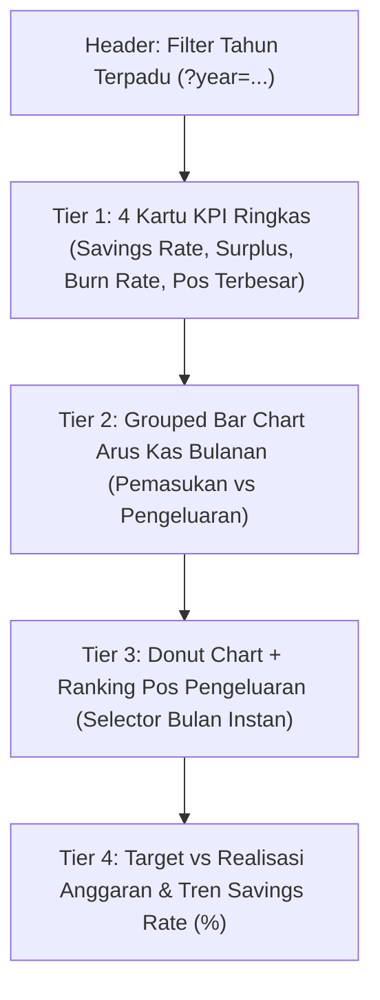

# PLANANALYTICS — Perombakan Halaman Analitik Finansial 4-Tier

> **Status:** COMPLETED ✅  
> **Goal:** Merombak halaman `/dashboard/analytics` menjadi pusat analitik arus kas, komposisi pengeluaran, dan disiplin anggaran berbasis prinsip **1 Grafik = 1 Pertanyaan Finansial** dalam 4 Tier (KPI Ringkas → Grouped Bar Arus Kas → Donut + Ranking Pos → Budget vs Aktual & Tren Savings Rate), bebas redundansi dengan Dashboard utama.  
> **Aturan eksekusi:** 1 fase per iterasi → `IMPLEMENTED — AWAITING APPROVAL` → approve Ken (ceklis kotak) → lanjut ke fase berikutnya hanya bila diinstruksikan. (Batch authorization executed for Fase A1–A3).

---

## 1. Arsitektur Target (4-Tier Hierarchy)

---

## 2. Rincian Fase & Checklist Eksekusi

### [x] Fase A1 — Kontrak Tipe & Query Layer Agregasi Multi-Bulan
- [x] Perbarui `src/types/analytics.ts` (tambah `AnalyticsMonthOption`, `categoryDistributionByMonth`, `availableMonths`).
- [x] Perbarui `getAnalyticsDashboardData` di `src/lib/queries/analytics.ts` untuk menyuplai data per bulan (`monthId` & `"all"`) dalam 1 query paralel.
- [x] Verifikasi `bun run typecheck` PASS.

### [x] Fase A2 — Komponen Modular Tier 1–4 (`src/components/features/analytics/`)
- [x] Buat `AnalyticsKpiGrid.tsx` (4 KPI card `tabular-nums`, 0 monospace).
- [x] Buat `MonthlyCashflowChart.tsx` (Grouped Bar Chart Recharts dengan `var(--border)`/`var(--muted-foreground)`, custom dark-aware tooltip, dan empty state).
- [x] Buat `ExpenseDonutSection.tsx` (Selector Bulan + Donut Chart Top 5–6 + *Lainnya* dengan Total Belanja di tengah donat + Ranked List berikon `AppCategoryIcon`).
- [x] Buat `BudgetDisciplineSection.tsx` (Target vs Realisasi Anggaran per pos + Tren Savings Rate % AreaChart).
- [x] Rombak `AnalyticsDashboard.tsx` & perbarui `index.ts` barrel export.

### [x] Fase A3 — Integrasi Page Orchestrator, Skeleton, Tests & Dokumentasi
- [x] Perbarui `src/app/(dashboard)/dashboard/analytics/page.tsx` (dukung `searchParams.year` + `Suspense` fallback `AnalyticsSkeleton`).
- [x] Selaraskan `AnalyticsSkeleton` di `src/components/layout/PageSectionSkeleton.tsx`.
- [x] Buat `src/components/features/analytics/__tests__/AnalyticsDashboard.test.tsx` dan selaraskan `frontend-phases-f7-f18.test.tsx`.
- [x] Jalankan `bun run typecheck && bun test && bun run build` (semua PASS).
- [x] Perbarui `.changelog/` dan `laporan.md`.
