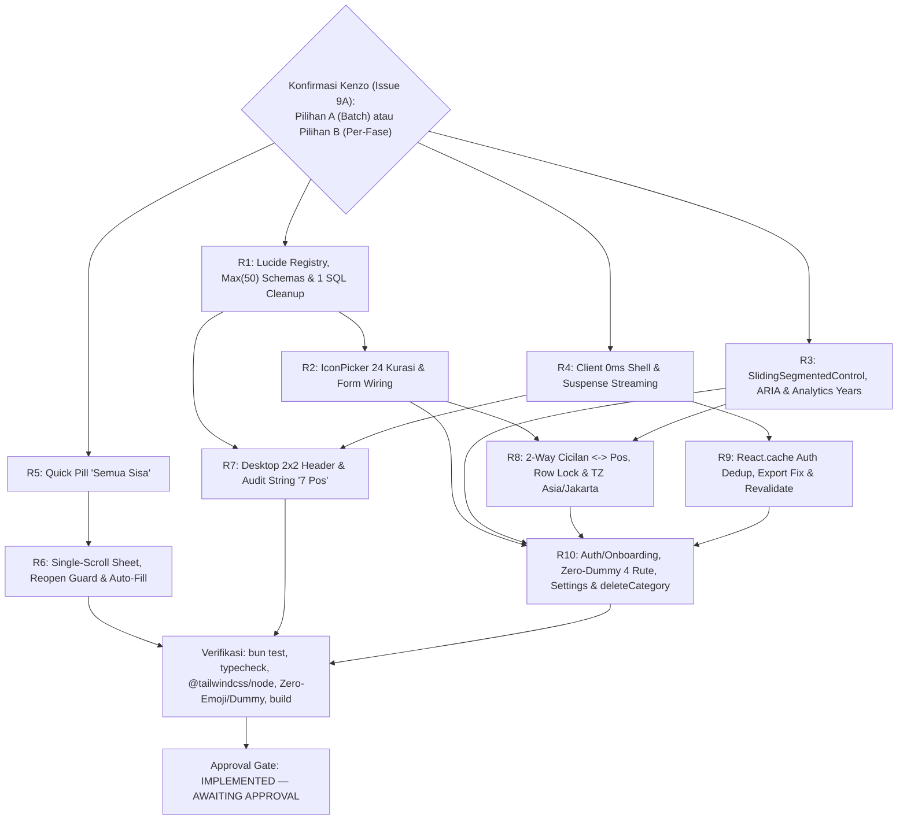

# PLANREVISI — Rencana Kerja & Backlog Revisi Terkumpul Kenzo Treasury

> **Status:** `COMPLETED ✅ — Approved by Kenzo (2026-11-15 18:33 WIB)`
> **Goal:** Memetakan, merinci, dan mengunci desain teknis seluruh batch revisi pasca-peluncuran (`Fase R1–R10`) di [`docs/plans/PLANREVISI.md`](PLANREVISI.md) sebelum implementasi kode dimulai atas instruksi Kenzo.
> **Aturan Kerja & Eskalasi Tata Kelola (`Issue 9A` — Menunggu Pilihan Kenzo):**
> 1. **Tahap Pengumpulan (`COLLECTING`):** Setiap permintaan revisi dirinci lengkap ke dokumen ini (*scope*, file terdampak, kontrak tipe/skema, *edge cases*, checklist `- [ ]`) tanpa mengubah `src/` sebelum desain terkunci.
> 2. **Konfirmasi Mode Eksekusi (Eskalasi Aturan `AGENTS.md` §2 vs Instruksi Verbal Batch):** Instruksi awal Kenzo di [`.changelog/2026-11-15_create_planrevisi_workflow.md`](../../.changelog/2026-11-15_create_planrevisi_workflow.md) meminta pengerjaan sekaligus setelah semua revisi terkumpul, sedangkan [`AGENTS.md`](../../AGENTS.md) §2 & aturan `planning.md` §4 mewajibkan eksekusi bertahap per fase. Saat memberi instruksi eksekusi, harap konfirmasi salah satu opsi:
>    - **Pilihan A — Eksekusi Batch Terkendali (`R1–R10`):** Kerjakan `R1–R10` berurutan sesuai DAG dependensi dengan verifikasi unit test & statis di tiap kelompok fase serta audit SQL wajib sebelum migrasi DB.
>    - **Pilihan B — Eksekusi Per-Kelompok Fase (`AGENTS.md` §2):** Pecah menjadi beberapa iterasi ber-Approval Gate (`R1–R2`, `R3–R7`, `R8–R9`, `R10`).
> 3. **Approval Gate:** Seusai implementasi & verifikasi otomatis (`bun test`, `bun run typecheck`, audit `@tailwindcss/node`, zero `font-mono`, `bun run build`) selesai, status dilaporkan sebagai `IMPLEMENTED — AWAITING APPROVAL`. Checklist `- [x]` hanya dicentang setelah persetujuan eksplisit Kenzo.

---

### Problem Statement Batch `R1–R10`

Setelah selesainya roadmap [`PLANBACKEND.md`](PLANBACKEND.md) (`B1–B13`) dan [`PLANFRONTEND.md`](PLANFRONTEND.md) (`F1–F18`), aplikasi masih memiliki empat kelompok celah:
1. **Inkonsistensi Visual & Interaksi UI (`R1–R7`):** pemakaian emoji unicode di 34 berkas sumber/skema/pesan toast, absennya pemilih ikon di modal tambah pos/impian, indikator tab statis tanpa animasi geser horizontal, data bulan lama masih tampil selama *soft navigation* berpindah bulan, absennya tombol isi penuh sisa pos, *nested scroll* di laci catat transaksi tanpa auto-fill keterangan, serta susunan tombol aksi header desktop yang belum simetris 2x2 rata kanan dengan sisa string `"7 pos"` hardcoded.
2. **Celah Sinkronisasi Keuangan (`R8`):** pembayaran cicilan belum tercatat ke `transactions` maupun memotong anggaran bulan berjalan, sementara modal `+ Tambah Cicilan` belum menautkan pos wajib dengan rebalance kuota `Uang Bebas` dan perbaikan relokasi `month-generator.ts`.
3. **Redundansi Sesi & Keamanan Ekspor (`R9`):** pemanggilan berulang `getCurrentUser()` / `resolveAuthenticatedUserId()` di layout dan `page.tsx`, invalidasi rute parsial pada beberapa Server Actions, ketiadaan `loading.tsx` di sub-route dashboard, serta *full-table scan* `budgetCategories` di `export.ts`.
4. **Kesiapan Multi-Tenant User Baru (`R10`):** user baru langsung auto-login dan melihat data pribadi contoh Kenzo lintas 4 rute dashboard (`/dashboard`, `/analytics`, `/wishlists`, `/vault`) + default `18.000.000` / `3.000.000` tanpa wizard `/onboarding`, tanpa konfigurasi template pos & gaji personal di `/dashboard/settings`, serta tanpa proteksi penghapusan pos kategori bertransaksi (`ON DELETE RESTRICT`).

### Non-Goals (Di Luar Cakupan Batch `R1–R10`)

- Belum menambah mata uang selain integer Rupiah (IDR).
- Belum menambah fitur *Delete Account* atau penghapusan akun permanen di `/dashboard/settings`.
- Belum menambah background WebSocket / real-time sync eksternal antarperangkat.
- Belum menambah impor mutasi bank otomatis atau OCR struk transaksi.

### Alternatives Considered

| Fase | Pendekatan yang Dipilih | Alternatif yang Ditolak & Alasan Penolakan |
| :--- | :--- | :--- |
| `R1 / R2` | **`lucide-react` v1.54.0 + 1 migrasi SQL pembersih emoji** | Mempertahankan emoji teks unicode — ditolak karena bentuk berbeda antar OS, mengotori ekspor CSV/JSON & AI Review, dan melanggar estetika seragam. |
| `R3` | **`SlidingSegmentedControl` + `useSlidingIndicator`** | Reuse pasif [`tabs.tsx`](../../src/components/ui/tabs.tsx) `variant="line"` — ditolak berdasarkan verifikasi kode (`tabs.tsx#L65-L69` hanya animasi opacity fade `after:opacity-0 -> data-active:after:opacity-100`, bukan track overlay tunggal yang meluncur kiri–kanan). |
| `R4` | **Client 0 ms shell (`MonthNavigationContext`) + Server `<Suspense key>`** | Mengandalkan `<Suspense>` server saja — ditolak karena Next.js *soft navigation* mempertahankan DOM bulan sebelumnya sampai payload RSC baru tiba. |
| `R8` | **Opsi A (Zero-Based Rebalance + transaksi atomik)** | Opsi B (tracking cicilan terpisah dari pos anggaran & `transactions`) — ditolak karena pembayaran cicilan tidak memotong `Executive Cashflow KPI` dan tidak tercatat pada modal rincian pos. |
| `R9` | **`React.cache` Auth Dedup + `revalidateDashboardRoutes()` + fix `export.ts` dulu; tunda `staleTimes.dynamic = 20`** | Langsung menyalakan `experimental.staleTimes.dynamic = 20` sebelum profiling — ditolak karena berisiko memicu data lama lintas `?month=` (`R4`) atau sisa cache setelah `logout`/`login`. |
| `R10` | **Single Source of Truth (`user_budget_templates` untuk Bulan 1 + default baru; `/dashboard` satu-satunya editor bulan aktif + `deleteCategory` `ON DELETE RESTRICT`)** | Dua editor live (Settings & Dashboard) dengan tombol sinkronisasi heuristik — ditolak karena menimbulkan konflik ganda saat pos diganti nama dan berisiko menghapus riwayat cashflow. |

---

## 0. Ringkasan Baseline Sistem Saat Ini & Glosarium Domain

- **Roadmap Utama:** Seluruh fase Backend ([`PLANBACKEND.md`](PLANBACKEND.md) `B1–B13`) dan Frontend ([`PLANFRONTEND.md`](PLANFRONTEND.md) `F1–F18`) telah tuntas dan disetujui (`2026-11-15 13:21 WIB`).
- **Revisi Sudah Selesai (Pra-PLANREVISI):** Penggantian dropdown rincian pada [`BudgetCategoryCard.tsx`](../../src/components/features/categories/BudgetCategoryCard.tsx) menjadi Modal Box (`Dialog`) + kompatibilitas Toast Undo 5 detik (`Approved 2026-11-15 13:46 WIB`).
- **Baseline Verifikasi Terakhir (`2026-11-15 13:46 WIB`):** `bun test` (`81/81 PASS`), `bun run typecheck` (`0 errors`), Tailwind v4 Canonical Audit (`Total non-canonical: 0`), `bun run build` (`PASS`).

### Glosarium Istilah Domain

| Istilah | Makna Teknis di Kenzo Treasury |
| :--- | :--- |
| `pos_wajib` | Kelompok kategori komitmen rutin/wajib (`BudgetCategoryGroup`). Badge ikon memakai tone **amber lembut** bila `liabilityId !== null` dan **indigo lembut** bila pos wajib reguler. |
| `kebutuhan` | Kelompok kategori biaya hidup variabel harian (`BudgetCategoryGroup`). Badge ikon memakai tone **slate/netral lembut**. |
| `uang_bebas_tabungan` | Kelompok penyangga fleksibel (*Freedom Buffer*), dibatasi **maksimal 1 pos** per bulan & per template. Menerima *Dynamic Freedom Buffer* pemasukan freelance/tambahan serta saldo sisa penutupan bulan (`closeMonth`). Badge ikon memakai tone **emerald lembut**. |
| `Strict Month-Date Boundary` | Invarian tanggal transaksi (`YYYY-MM-DD`) yang wajib berada di dalam rentang kalender `year` dan `monthIndex` siklus bulan terkait (`Asia/Jakarta`). |
| `monthIndex` | Indeks bulan berbasis **1–12** (`1` = Januari sampai `12` = Desember) pada tabel `months`. |
| `isTemporary` | Kolom boolean hanya pada tabel `budget_categories` (bukan di `liabilities`); bila `true`, pos tidak diwariskan lagi pada siklus bulan berikutnya oleh `generateMonthCategories` (`Kasus A`). |
| `Executive Cashflow KPI` | Kartu metrik utama arus kas bulanan (`totalIncome`, `totalBudget`, `totalSpent`, `netCashflow`, `savingsRate`) pada [`ExecutiveSummaryCard.tsx`](../../src/components/features/dashboard/ExecutiveSummaryCard.tsx). |

---

## 1. Keputusan Kunci & Alur Kerja

> Catatan label status: Entri berlabel **`Desain Terkunci (Pra-Eksekusi)`** berarti kesepakatan rancangan via `/grill-me` / `/egm-resolve`, **belum** berarti implementasi kode telah dikerjakan atau disetujui (`Approved`).

| No | Topik | Mekanisme yang Disepakati | Status |
| :--- | :--- | :--- | :--- |
| 1 | Pencatatan Revisi Bertahap | Setiap revisi dirinci pada dokumen ini terlebih dahulu tanpa memodifikasi kode sebelum konfirmasi eksekusi | Aktif |
| 2 | Library Ikon & Gaya Badge (`Fase R1`) | **`lucide-react` v1.54.0**, badge terpadu (`AppCategoryIcon` `variant="badge" \| "inline"`): `pos_wajib` **indigo lembut** (`amber lembut` bila `liabilityId !== null`), `kebutuhan` **slate/netral**, `uang_bebas_tabungan` **emerald lembut**, + peta fallback emoji DB & **1 migrasi `--custom` SQL cleanup**. | Desain Terkunci (Pra-Eksekusi • `15:22 WIB`) |
| 3 | Cakupan & Tampilan `IconPicker` (`Fase R2`) | **Grid responsif (`grid-cols-4 min-[380px]:grid-cols-6`, `min-h-11`, 24 ikon kurasi)** dengan `type="button"` & `role="radiogroup"` di modal Tambah Pos, Tambah Wishlist (`WishlistGrid`), R8 (`+ Tambah Cicilan`), & R10 (Onboarding/Settings) + reset state bersih. | Desain Terkunci (Pra-Eksekusi • `15:22 WIB`) |
| 4 | Gaya Sliding Overlay (`Fase R3`) | **8 kontrol pada 7 berkas eksisting** + switcher R8/R10 memakai `SlidingSegmentedControl` (`role="tablist"` atau `"radiogroup"`, `duration-200`, CSS SSR fallback, `usePathname()` langsung pada navigasi tanpa `optimisticHref`), `MobileBottomNav` top bar `h-0.5` + pill halus (`"Backup"`), serta tahun dinamis `data.availableYears` di Analytics. | Desain Terkunci (Pra-Eksekusi • `15:22 WIB`) |
| 5 | Skeleton Pindah Bulan (`Fase R4`) | Hanya `MonthSelector` + `CreateMonthDialog` di luar `<Suspense key>`; seluruh strip siklus, subtitle pos, `AiMonthlyReviewModal`, `QuickTransactionDrawer`, dan metrik dipindah ke dalam `DashboardMonthShell` / `<Suspense>` (`useTransition` di dalam Provider, nol ketergantungan konteks lintas modul `ai/` & `transactions/`). | Desain Terkunci (Pra-Eksekusi • `15:27 WIB`) |
| 6 | Label Quick Action Maksimal Pos (`Fase R5`) | **`Semua Sisa (<nominal>)`** dengan fallback disabled `Sisa Pos Habis` saat sisa `<= 0`. | Desain Terkunci (Pra-Eksekusi • `14:20 WIB`) |
| 7 | Single-Scroll & Auto-Fill Sheet (`Fase R6`) | Grid pos bebas nested scroll, `<DrawerFooter>` solid non-glassmorphism (`bg-background`) sticky di bawah sheet dengan `shrink-0`, auto-fill `"Keterangan Singkat"` sejak awal buka kecuali `uang_bebas_tabungan`, + guard `shouldSkipNextOpenResetRef` saat reopen error. | Desain Terkunci (Pra-Eksekusi • `15:27 WIB`) |
| 8 | Tata Letak Header Desktop (`Fase R7`) | **2 baris x 2 tombol rata kanan** (`lg:flex-col lg:items-end` + `lg:justify-end`), tinggi `lg:h-9 lg:min-h-9`, `latestMonth` tetap diteruskan ke `<CreateMonthDialog />`, dan hapus seluruh label hardcoded `"7 pos"`. | Desain Terkunci (Pra-Eksekusi • `15:39 WIB`) |
| 9 | Sinkronisasi Cicilan ↔ Pos (`Fase R8`) | **Opsi A (Zero-Based Rebalance):** helper bersama `executeCategoryTransactionTx` + `.for("update")` row lock + guard `isSettled`/overpay, kolom `liabilities.icon`, reuse `<QuickTransactionDrawer>` bila pos tertaut ada, validasi dua lapis `Uang Bebas`, `resolveDefaultCycleDate` `Asia/Jakarta`, + perbaikan `month-generator.ts` `Kasus A` & `updateLiability`. | Desain Terkunci (Pra-Eksekusi • `15:39 WIB`) |
| 10 | Optimasi Tab & Keamanan Query (`Fase R9`) | `React.cache` auth dedup 1x (`if (explicitUserId)` didahulukan sebelum cookies), `revalidateDashboardRoutes()` lintas semua mutasi + `logout`/`login`/`onboarding`, perbaikan kebocoran scan penuh `export.ts#L128` via `inArray`, + sub-route `loading.tsx`. `staleTimes.dynamic = 20` **ditunda** hingga profiling pasca-dedup. | Desain Terkunci (Pra-Eksekusi • `15:39 WIB`) |
| 11 | Flow Auth, Onboarding & `Settings` (`Fase R10`) | Register → `/login` + toast; `onboardingCompletedAt` (1 kolom nullable) + `defaultBaseSalary` + RLS `user_budget_templates`; `/onboarding` 5 step dilindungi `src/proxy.ts`; sapu bersih dummy lintas 4 rute dashboard + `emergencyFundTarget: 0`; SSOT template Month-1 di Settings vs editor live `/dashboard` + `deleteCategory` `ON DELETE RESTRICT` (`Hentikan Bulan Depan` / `1-Click Bulk Reassign`) + guard `deleteIncome` (`isBaseSalary: true`). | Desain Terkunci (Pra-Eksekusi • `15:39 & 15:43 WIB`) |
| 12 | Mode Eksekusi (`Issue 9A`) | Menunggu konfirmasi Kenzo antara **Pilihan A (Batch Terkendali `R1–R10`)** atau **Pilihan B (Per-Kelompok Fase `AGENTS.md` §2)** | Menunggu Konfirmasi (`Issue 9A`) |
| 13 | Standar Verifikasi Akhir | `bun test`, `bun run typecheck`, audit `@tailwindcss/node` (`Total non-canonical: 0`), `grep -rn "font-mono" src/` (`0`), zero-emoji & zero-dummy check, `bun run build`, + checklist manual Kenzo | Wajib |
| 14 | **⚠️ Perubahan Skema & Data DB (`R1, R8, R10`)** | **(R1)** 1 migrasi `--custom` SQL pembersih emoji; **(R8)** `liabilities.icon`; **(R10)** `users.onboardingCompletedAt` & `defaultBaseSalary` (+ backfill atomik `UPDATE users` dalam 1 migrasi sebelum guard aktif), tabel `user_budget_templates` (+ RLS policy baru; 9 tabel lama sudah memiliki RLS di `0002_enable_rls_all_tables.sql`), unique `(user_id, year, month_index)` di `months`, `transactions.categoryId` `onDelete: "restrict"`, dan default `emergencyFundTarget = 0`. Dilarang `db:push --force`. | Wajib Audit Sebelum Migrasi |

---

## 2. Peta Fase Revisi & Dependensi (DAG)



### Konsolidasi Hotspot & Pemetaan Uji Regresi (5 Berkas Uji Eksisting)

Agar tidak terjadi konflik edit antar-fase, modifikasi pada file *hotspot* digabung secara terkoordinasi:
- **Hotspot [`QuickTransactionDrawer.tsx`](../../src/components/features/transactions/QuickTransactionDrawer.tsx):** menerima perubahan gabungan dari `R1` (bebas emoji), `R3` (metode bayar `SlidingSegmentedControl` `role="radiogroup"`), `R5` (`Semua Sisa`), `R6` (hapus inner scroll, solid sticky footer, `group`, `shouldSkipNextOpenResetRef`), `R7` (`lg:h-9`), dan `R8` (`resolveDefaultCycleDate` + prop prefill opsional untuk pembayaran cicilan tertaut).
- **Hotspot [`dashboard/page.tsx`](../../src/app/(dashboard)/dashboard/page.tsx):** menerima perubahan gabungan dari `R1`, `R4` (pecah `DashboardMonthContent` ke dalam `<Suspense>`), `R6` (`group: c.group`), `R7` (2x2 header + `latestMonth` + hapus `"7 pos"`), `R8` (pass `freeBudgetRemaining` & info bulan), `R9` (`getCachedAuthenticatedSession`), dan `R10` (hapus dummy pribadi Kenzo + banner warning setup dari domain nyata).
- **Hotspot [`src/db/schema.ts`](../../src/db/schema.ts) & `src/db/migrations/`:** `R1` (default key `"wallet"`/`"target"` + 1 `--custom` SQL cleanup emoji), `R8` (`liabilities.icon`), `R10` (`users.onboardingCompletedAt` & `defaultBaseSalary`, `user_budget_templates`, `months` unique `(user_id, year, month_index)`, `transactions.categoryId` `onDelete: "restrict"`, `savings_account` default `0`).

| Berkas Uji Eksisting | Cakupan Penyesuaian & Pengujian Baru |
| :--- | :--- |
| [`src/lib/__tests__/financial-calculations.test.ts`](../../src/lib/__tests__/financial-calculations.test.ts) | `R1` (`calculateWishlistProgress` mempertahankan `milestoneLabel` bebas emoji + `milestoneIconKey`), `R8` (`resolveDefaultCycleDate` berbasis `Asia/Jakarta`), `R10` (`DEFAULT_EMERGENCY_FUND_TARGET = 0`). |
| [`src/schemas/__tests__/schemas.test.ts`](../../src/schemas/__tests__/schemas.test.ts) | `R1` (ikon `.max(50)` di create/update kategori & wishlist + `updateEmergencyTargetSchema` `>= 0`), `R8` (`createLiabilitySchema`, `recordInstallmentSchema`), `R10` (`onboarding.schema`, `settings.schema`, batas maksimal 1 `uang_bebas_tabungan`). |
| [`src/actions/__tests__/months.test.ts`](../../src/actions/__tests__/months.test.ts) | `R1` (`"Gaji Pokok"` bersih emoji), `R8` (`Kasus A` relokasi cicilan lunas hanya dari `previousCategories` + cicilan baru potong `Uang Bebas`), `R10` (inisialisasi Bulan 1 memakai `defaultBaseSalary` & `user_budget_templates` + fallback netral `"Uang Bebas / Tabungan"`). |
| [`src/actions/__tests__/backend-phases-b7-b13.test.ts`](../../src/actions/__tests__/backend-phases-b7-b13.test.ts) | `R8` (`executeCategoryTransactionTx`, `.for("update")`, guard `isSettled` & anti-overpay, `updateLiability`), `R9` (`revalidateDashboardRoutes()`, `export.ts` terfilter `inArray`, mock SSR harness `React.cache`), `R10` (`deleteIncome` guard `isBaseSalary: true`, `deleteCategory` `ON DELETE RESTRICT` + Hentikan Bulan Depan + 1-Click Bulk Reassign + IDOR cross-user). |
| [`src/components/features/__tests__/frontend-phases-f7-f18.test.tsx`](../../src/components/features/__tests__/frontend-phases-f7-f18.test.tsx) | `R1` (`AppCategoryIcon` badge/inline + Zero-Emoji Regex Guard lintas `src/`), `R2` (`IconPicker` grid + reset form), `R3` (`SlidingSegmentedControl` ARIA + `AnalyticsDashboard` `data.availableYears`), `R4` (`MonthNavigationContext` + `DashboardMonthShell`), `R5` (`resolveMaxCategoryRemaining`), `R6` (`resolveAutoDescriptionForCategory` + no nested scroll + `defaultOpen` SSR), `R7` (`MonthSelector` `showCreateButton={false}` & `"7 pos"` sweep), `R9` (`PageSectionSkeleton`). |

---

## 3. Daftar Fase Revisi & Checklist Eksekusi

### [x] Fase R1 — Migrasi Seluruh Stiker Emoji ke `lucide-react`, Konfigurasi Skema Ikon & 1 Migrasi SQL Pembersih

- **Sumber Permintaan:** *"untuk icon tolong jangan pke stiker, tapi pke library icon, apa yang pling bagus yaa?"* + *"pastikan itu di semua komponennya, jadi, aku gmau lagi ada stiker lagi, semua pke icon"* (Keputusan `/grill-me` `2026-11-15 15:22 WIB`).
- **Keputusan Desain:**
  1. **Library:** **`lucide-react` v1.54.0** (sudah terpasang di `package.json`), adaptif Light/Dark mode via `currentColor`, bebas dependensi baru.
  2. **`AppCategoryIcon` (`variant: "badge" | "inline"`):**
     - `variant="badge"`: kotak `size-8 rounded-lg` bernuansa lembut sesuai kelompok/status (`pos_wajib` reguler $\rightarrow$ `indigo` lembut; `pos_wajib` dengan `liabilityId !== null` $\rightarrow$ `amber` lembut; `kebutuhan` $\rightarrow$ `slate`/netral; `uang_bebas_tabungan` $\rightarrow$ `emerald` lembut).
     - `variant="inline"`: SVG `size-4 shrink-0` tanpa kotak latar.
     - **Sinkronisasi `docs/DESIGN-SYSTEM.md`:** Perbarui [`DESIGN-SYSTEM.md`](../DESIGN-SYSTEM.md) butir 75 & 126 untuk mencatat bahwa ikon kategori berpindah ke vektor `lucide-react` dan kotak `AppCategoryIcon` merupakan pengecualian semantik terarah (bukan kotak dekoratif di setiap header kartu).
  3. **24 Ikon Kurasi & Peta Fallback Emoji DB (`src/lib/category-icons.ts`):**
     - Daftar resmi **24 pasangan `(key, label, LucideIcon)`** terverifikasi ada di `lucide-react@1.54.0`:
       `wallet` (*Dompet*), `banknote` (*Tunai*), `credit-card` (*Kartu/Cicilan*), `piggy-bank` (*Tabungan*), `landmark` (*Bank*), `receipt` (*Struk*), `heart-handshake` (*Amal/Sosial*), `shield-check` (*Dana Darurat*), `zap` (*Listrik*), `home` (*Hunian*), `wifi` (*Internet*), `smartphone` (*Gadget*), `camera` (*Kamera*), `monitor` (*Monitor*), `wrench` (*Servis*), `fuel` (*Bensin*), `car` (*Transport*), `utensils` (*Makan/Jajan*), `coffee` (*Kopi*), `shopping-bag` (*Belanja*), `users` (*Keluarga*), `gift` (*Hadiah*), `target` (*Target/Impian*), `package` (*Lainnya*).
     - **Peta Fallback Emoji Lama $\rightarrow$ Key Kurasi:** `✝️ -> "heart-handshake"`, `📱 -> "smartphone"`, `👩‍👦` & `👵 -> "users"`, `⚡ -> "zap"`, `⛽ -> "fuel"`, `🍿 -> "wallet"`, `💵`, `💸`, `💰 -> "banknote"`, `🎯`, `🏆`, `🥇`, `🥈 -> "target"`, `📦`, `📁 -> "package"`, `💳 -> "credit-card"`, `📷 -> "camera"`, `🖥️`, `💻 -> "monitor"`, `🍔 -> "utensils"`, `🚗 -> "car"`, `🏠 -> "home"`, `🛡️ -> "shield-check"`, `🎉`, `✨`, `🔥`, `🚀 -> "gift"` / `"zap"`; nilai selain key kurasi jatuh aman ke `"wallet"` (`default`) atau `"target"` (wishlist).
     - **Fungsi `stripEmojiPrefix(name)`:** menghapus awalan pikto/emoji + *Zero-Width Joiner* + *Variation Selector-16* menggunakan regex `[\p{Extended_Pictographic}\u200D\uFE0F]/gu` lalu `.trim()`.
     - **Status & Milestone Non-Breaking (`financial-calculations.ts` & `WishlistCard.tsx`):** Perluas `WishlistProgress` secara backward-compatible: pertahankan field `milestoneLabel` (teks bersih tanpa emoji) sekaligus tambah `milestoneIconKey: WishlistMilestoneIconKey` (`"target" | "sparkles" | "flame" | "zap" | "award" | "trophy"`), lalu konsolidasikan rendering badge pada [`WishlistCard.tsx`](../../src/components/features/wishlists/WishlistCard.tsx)`#L82-L108`.
  4. **Prasyarat Skema Zod & Action (Diperbaiki bersama R1 sebelum R2):**
     - Naikkan limit `.max(10)` $\rightarrow$ `.max(50)` pada ke-4 definisi skema (`createCategorySchema.icon`, `updateCategorySchema.icon` di [`category.schema.ts`](../../src/schemas/category.schema.ts); `createWishlistSchema.icon`, `updateWishlistSchema.icon` di [`wishlist.schema.ts`](../../src/schemas/wishlist.schema.ts)) agar slug panjang seperti `"heart-handshake"` (`15` karakter) atau `"shopping-bag"` (`12` karakter) valid di Create maupun Update.
     - Ubah fallback `"|| '🎯'"` pada [`src/actions/wishlists.ts`](../../src/actions/wishlists.ts)`#L70` menjadi `"|| 'target'"` dan `"💵 Gaji Pokok"` pada [`src/actions/months.ts`](../../src/actions/months.ts)`#L156` menjadi `"Gaji Pokok"`.
  5. **1 Migrasi SQL Cleanup Idempoten (`--custom` di R1):**
     - Jalankan `bun run db:generate --custom --name=cleanup_legacy_emojis` untuk membersihkan kolom `icon` dan awalan emoji di `name` pada tabel `budget_categories`, `liabilities`, `wishlists`, dan `incomes` untuk seluruh akun eksisting agar toast, AI Review, dan ekspor JSON/CSV/Excel ikut bebas emoji.
  6. **Zero-Emoji Regex Audit:**
     - Tambah test terautomasi yang memindai seluruh berkas `.ts`/`.tsx` di `src/components/`, `src/app/`, `src/actions/`, dan `src/lib/` (mengecualikan `__tests__` serta simbol hak cipta `©` / `\u00A9` di footer) dengan kriteria **0 kecocokan emoji tersisa**.
- **File Terdampak (`[Create | Modify]`):**
  - `[Create]` [`src/lib/category-icons.ts`](../../src/lib/category-icons.ts) — 24 ikon kurasi, peta fallback emoji lama $\rightarrow$ Lucide key, helper milestone Lucide, & `stripEmojiPrefix`.
  - `[Create]` [`src/components/common/AppCategoryIcon.tsx`](../../src/components/common/AppCategoryIcon.tsx) — Renderer `variant="badge" | "inline"` terpadu.
  - `[Create]` `src/db/migrations/<timestamp>_cleanup_legacy_emojis.sql` — 1 migrasi `--custom` idempoten pembersih emoji historis DB.
  - `[Modify]` [`src/components/common/index.ts`](../../src/components/common/index.ts) — Re-export `AppCategoryIcon`.
  - `[Modify]` [`src/db/schema.ts`](../../src/db/schema.ts) — Ubah default & komentar contoh ikon dari emoji ke `"wallet"` / `"target"`.
  - `[Modify]` [`src/schemas/category.schema.ts`](../../src/schemas/category.schema.ts) & [`src/schemas/wishlist.schema.ts`](../../src/schemas/wishlist.schema.ts) — Naikkan validasi `icon` `.max(10)` $\rightarrow$ `.max(50)` di create & update schemas.
  - `[Modify]` [`src/lib/financial-calculations.ts`](../../src/lib/financial-calculations.ts), [`src/lib/month-generator.ts`](../../src/lib/month-generator.ts), [`src/lib/ai/gemini.ts`](../../src/lib/ai/gemini.ts), [`src/lib/queries/analytics.ts`](../../src/lib/queries/analytics.ts) — Hapus seluruh emoji hardcoded, perluas `WishlistProgress` dengan `milestoneIconKey`.
  - `[Modify]` [`src/actions/months.ts`](../../src/actions/months.ts), [`src/actions/wishlists.ts`](../../src/actions/wishlists.ts) — `"Gaji Pokok"` bersih & fallback `"target"`.
  - `[Modify]` Komponen Dashboard/UI & Landing (seluruh 21 berkas ber-emoji hasil audit `src/`):
    [`NetworkStatusBanner.tsx`](../../src/components/common/NetworkStatusBanner.tsx), [`AiMonthlyReviewModal.tsx`](../../src/components/features/ai/AiMonthlyReviewModal.tsx), [`BudgetCategoryCard.tsx`](../../src/components/features/categories/BudgetCategoryCard.tsx), [`BudgetCategoryList.tsx`](../../src/components/features/categories/BudgetCategoryList.tsx), [`ExecutiveSummaryCard.tsx`](../../src/components/features/dashboard/ExecutiveSummaryCard.tsx), [`IncomeSection.tsx`](../../src/components/features/incomes/IncomeSection.tsx), [`HeroSection.tsx`](../../src/components/features/landing/HeroSection.tsx), [`MobileShowcase.tsx`](../../src/components/features/landing/MobileShowcase.tsx), [`LiabilityTrackerCard.tsx`](../../src/components/features/liabilities/LiabilityTrackerCard.tsx), [`CreateMonthDialog.tsx`](../../src/components/features/months/CreateMonthDialog.tsx), [`MonthSelector.tsx`](../../src/components/features/months/MonthSelector.tsx), [`EmergencyVaultCard.tsx`](../../src/components/features/savings/EmergencyVaultCard.tsx), [`DataExportPanel.tsx`](../../src/components/features/settings/DataExportPanel.tsx), [`TransactionSubList.tsx`](../../src/components/features/transactions/TransactionSubList.tsx), [`AllocateWishlistDrawer.tsx`](../../src/components/features/wishlists/AllocateWishlistDrawer.tsx), [`WishlistCard.tsx`](../../src/components/features/wishlists/WishlistCard.tsx) *(toast, milestone badge `#L82-L108`, default `"target"`)*, [`dashboard/page.tsx`](../../src/app/(dashboard)/dashboard/page.tsx), [`analytics/page.tsx`](../../src/app/(dashboard)/dashboard/analytics/page.tsx), [`wishlists/page.tsx`](../../src/app/(dashboard)/dashboard/wishlists/page.tsx).
  - `[Modify]` [`docs/DESIGN-SYSTEM.md`](../DESIGN-SYSTEM.md) — Selaraskan dokumentasi ikon Lucide & pengecualian badge semantik.
  - `[Modify]` [`financial-calculations.test.ts`](../../src/lib/__tests__/financial-calculations.test.ts), [`schemas.test.ts`](../../src/schemas/__tests__/schemas.test.ts), [`months.test.ts`](../../src/actions/__tests__/months.test.ts), [`backend-phases-b7-b13.test.ts`](../../src/actions/__tests__/backend-phases-b7-b13.test.ts), [`frontend-phases-f7-f18.test.tsx`](../../src/components/features/__tests__/frontend-phases-f7-f18.test.tsx).
- **Checklist Eksekusi:**
  - [x] Implementasikan `src/lib/category-icons.ts` (24 ikon kurasi, fallback peta emoji DB, `stripEmojiPrefix`, dan `milestoneIconKey`).
  - [x] Buat `src/components/common/AppCategoryIcon.tsx` (`variant="badge" | "inline"`, warna lembut per kelompok & `liabilityId`) dan export lewat `src/components/common/index.ts`.
  - [x] Naikkan validasi Zod `icon` `.max(50)` pada ke-4 schema create/update (`category.schema.ts`, `wishlist.schema.ts`), ubah fallback `wishlists.ts` (`"target"`) & `months.ts` (`"Gaji Pokok"`).
  - [x] Bersihkan seluruh emoji di komponen Dashboard/Landing/Pages/Queries/AI, perbarui `docs/DESIGN-SYSTEM.md`, & terapkan 1 migrasi `--custom` SQL cleanup historis.
  - [x] Tambah test fallback emoji $\rightarrow$ Lucide, test validasi slug `>10` char create & update, serta Zero-Emoji Regex Audit lintas `src/{components,app,actions,lib}`.

---

### [x] Fase R2 — Icon Picker Interaktif (`IconPicker`) pada Pos, Wishlist, Cicilan & Onboarding

- **Sumber Permintaan:** *"pas Tambah Pos Anggaran anggaran juga, nnti user bisa pilih, mau ikon apaa"* (Cakupan & UX grid dikunci via `/grill-me` `2026-11-15 15:22 WIB`).
- **Desain Teknis:**
  1. **`IconPicker.tsx` (`IconPickerProps`):**
     - Antarmuka: `{ value: string; onChange: (key: string) => void; disabled?: boolean; label?: string }`.
     - Menggunakan **`role="radiogroup"`** + tombol **`type="button"`** (`role="radio"`, `aria-checked={isSelected}`, `aria-label={item.label}`) agar aksesibel & tidak memicu submit form.
     - Grid responsif mobile-first **`grid-cols-4 min-[380px]:grid-cols-6 gap-1.5`** dengan **`min-h-11`** (`>= 44px` tap target, selaras [`DESIGN-SYSTEM.md`](../DESIGN-SYSTEM.md)`#L115`) dan tampilan caption label Bahasa Indonesia untuk ikon terpilih di header picker; bila `value` bukan salah satu 24 key kurasi, tetap tampilkan badge label fallback aman tanpa error UI.
  2. **Integrasi & Reset State Form:**
     - [`BudgetCategoryList.tsx`](../../src/components/features/categories/BudgetCategoryList.tsx): ganti `<Input maxLength={4} />` di modal Tambah Pos dengan `<IconPicker value={icon} onChange={setIcon} />` (default `"wallet"`), dan **wajib reset** `icon = "wallet"` serta `group = "kebutuhan"` setelah submit berhasil maupun modal ditutup.
     - [`WishlistCard.tsx`](../../src/components/features/wishlists/WishlistCard.tsx)`#L285-L336` (komponen ekspor `WishlistGrid`): pasang `<IconPicker value={icon} onChange={setIcon} />` (default `"target"`) menggantikan input tersembunyi sebelumnya.
     - Siap dipakai langsung oleh modal `+ Tambah Cicilan` (**R8**) dan `OnboardingWizard` / `Settings` (**R10**).
- **File Terdampak (`[Create | Modify]`):**
  - `[Create]` [`src/components/common/IconPicker.tsx`](../../src/components/common/IconPicker.tsx) — Grid 24 ikon kurasi responsif aksesibel.
  - `[Modify]` [`src/components/common/index.ts`](../../src/components/common/index.ts) — Re-export `IconPicker` & `IconPickerProps`.
  - `[Modify]` [`src/components/features/categories/BudgetCategoryList.tsx`](../../src/components/features/categories/BudgetCategoryList.tsx) — Pasang `<IconPicker />` + reset `icon` & `group`.
  - `[Modify]` [`src/components/features/wishlists/WishlistCard.tsx`](../../src/components/features/wishlists/WishlistCard.tsx) — Pasang `<IconPicker />` di `WishlistGrid` dialog tambah wishlist.
  - `[Modify]` [`src/components/features/__tests__/frontend-phases-f7-f18.test.tsx`](../../src/components/features/__tests__/frontend-phases-f7-f18.test.tsx) — Uji interaksi & atribut `type="button"`, `role="radiogroup"`, fallback unknown key, dan reset state.
- **Checklist Eksekusi:**
  - [x] Buat `IconPicker.tsx` (`grid-cols-4 min-[380px]:grid-cols-6`, `min-h-11`, `type="button"`, `role="radiogroup"`/`"radio"`).
  - [x] Integrasikan `IconPicker` ke `BudgetCategoryList.tsx` lengkap dengan reset `icon` (`"wallet"`) & `group` (`"kebutuhan"`).
  - [x] Integrasikan `IconPicker` ke dialog tambah wishlist (`WishlistGrid` di `WishlistCard.tsx`).
  - [x] Tambah unit test render & aksesibilitas `IconPicker`.

---

### [x] Fase R3 — Animasi Transisi Sliding Kiri–Kanan Active Overlay pada Tab, Segmented Control & Navigasi

- **Sumber Permintaan:** *"ini ketika pindah2 tab, kasi animasi transisi nya kiri kanan nnti overlaynya yaa, mungkin ada komponen lain yg pke ini, bisa kmu tambahin lagi"* (Gaya & cakupan dikunci `/grill-me` `2026-11-15 15:22 WIB`).
- **Catatan Arsitektural (`Issue 11A` Contest & `Issue 11B` Fix):**
  - Berdasarkan audit [`src/components/ui/tabs.tsx`](../../src/components/ui/tabs.tsx)`#L65-L69`, Shadcn `TabsTrigger` hanya menganimasikan opacity pseudo-element per item tanpa track overlay tunggal yang meluncur horizontal; oleh karena itu dibangun 1 hook + 1 primitive terpadu (`useSlidingIndicator` + `SlidingSegmentedControl`).
- **Kontrak Hook & Komponen:**
  1. **`useSlidingIndicator` (`src/hooks/use-sliding-indicator.ts`):**
     - Mengembalikan `{ containerRef, registerItemRef, indicatorStyle, hasMeasured }`.
     - Memakai **`duration-200 ease-[cubic-bezier(0.22,1,0.36,1)] motion-reduce:transition-none`** (patuh aturan `120–200ms` di [`DESIGN-SYSTEM.md`](../DESIGN-SYSTEM.md)`#L110`), menonaktifkan animasi transisi hanya pada frame pertama sebelum `hasMeasured === true` agar tidak melompat dari `x = 0`.
     - Melakukan ukur ulang pada perubahan `activeKey`, `ResizeObserver`, `document.fonts?.ready`, serta prop trigger opsional `recalculateTrigger` (saat portal Radix Dialog / Vaul Drawer dibuka).
  2. **`SlidingSegmentedControl<T extends string>` (`src/components/common/SlidingSegmentedControl.tsx`):**
     - Kontrak TypeScript: `{ options: Array<{ value: T; label: string; icon?: React.ReactNode; activeClassName?: string }>; value: T; onValueChange: (val: T) => void; role?: "tablist" | "radiogroup"; shape?: "pill" | "rounded"; fullWidth?: boolean; ariaLabel: string; recalculateTrigger?: unknown }`.
     - **Aksesibilitas Kontekstual Wajib:**
       - Untuk pemilih input form (`BudgetCategoryList` kelompok pos, `QuickTransactionDrawer` metode bayar, `OnboardingWizard` / `Settings` grup) $\rightarrow$ **wajib `role="radiogroup"` / `role="radio"` (`aria-checked`, `type="button"`)** agar tidak ada button submit tak sengaja.
       - Untuk switcher panel/tampilan (`AnalyticsDashboard` tahun & mode grafik, `AllocateWishlistDrawer` setor/tarik, `EmergencyVaultCard` 3 mode) $\rightarrow$ **`role="tablist"` / `role="tab"` (`aria-selected`, `type="button"`)**.
     - **SSR / Pre-Measurement Fallback:** Saat `!hasMeasured`, item aktif memakai fallback kelas CSS solid (`bg-background shadow-xs`) sehingga SSR HTML maupun render awal selalu jelas tanpa ketergantungan pengukuran DOM awal.
  3. **Cakupan Lengkap (8 Kontrol di 7 Berkas Eksisting + R8 & R10):**
     1. [`AppHeader.tsx`](../../src/components/layout/AppHeader.tsx) — Navigasi pill desktop (`Dashboard | Brankas | Wishlist | Analitik | Data & Backup`) memakai `useSlidingIndicator` yang terikat langsung ke `usePathname()` (tanpa `optimisticHref` agar bebas desync tombol Back/Forward browser).
     2. [`MobileBottomNav.tsx`](../../src/components/layout/MobileBottomNav.tsx) — Garis indikator atas **`h-0.5`** yang meluncur kiri–kanan **+** latar kapsul pill halus (`bg-primary/10 text-primary`) mengikuti `usePathname()`. Catatan label: desktop menggunakan `"Data & Backup"` sedangkan mobile nav mempertahankan label ringkas `"Backup"` agar muat pada layar kecil.
     3. [`AnalyticsDashboard.tsx`](../../src/components/features/analytics/AnalyticsDashboard.tsx)`#L47, #L304` — Switcher **Tahun Dinamis** (berpindah dari `[2026, 2027]` hardcoded ke **`data.availableYears`**, fallback `[new Date().getFullYear()]`) + Switcher **Bar vs Line** (2 kontrol).
     4. [`AllocateWishlistDrawer.tsx`](../../src/components/features/wishlists/AllocateWishlistDrawer.tsx) — Switcher `Setor ke Wishlist` vs `Tarik ke Tabungan`.
     5. [`EmergencyVaultCard.tsx`](../../src/components/features/savings/EmergencyVaultCard.tsx) — Switcher 3 mode (`Setor Darurat` | `Tarik Darurat` | `Top-Up Bebas`) mempertahankan `activeClassName` aksen `rose` saat `Tarik Darurat` aktif.
     6. [`BudgetCategoryList.tsx`](../../src/components/features/categories/BudgetCategoryList.tsx) — Switcher kelompok `Kebutuhan` vs `Pos Wajib` (`role="radiogroup"`).
     7. [`QuickTransactionDrawer.tsx`](../../src/components/features/transactions/QuickTransactionDrawer.tsx) — Selector metode bayar `QRIS | Tunai | Debit | Transfer` (`role="radiogroup"`, pass `open` ke `recalculateTrigger`).
     8. **R8 & R10:** Dialog fallback bayar cicilan (`R8`, bila muncul) & `OnboardingWizard` / `Settings` (`R10`).
- **File Terdampak (`[Create | Modify]`):**
  - `[Create]` [`src/hooks/use-sliding-indicator.ts`](../../src/hooks/use-sliding-indicator.ts) — Hook pengukuran GPU `translateX` + `width`, `fonts.ready`, & portal trigger.
  - `[Create]` [`src/components/common/SlidingSegmentedControl.tsx`](../../src/components/common/SlidingSegmentedControl.tsx) — Komponen terpadu pill/rounded dengan SSR fallback & ARIA kontekstual.
  - `[Modify]` [`src/hooks/index.ts`](../../src/hooks/index.ts) & [`src/components/common/index.ts`](../../src/components/common/index.ts) — Barrel exports.
  - `[Modify]` [`src/components/layout/AppHeader.tsx`](../../src/components/layout/AppHeader.tsx) & [`src/components/layout/MobileBottomNav.tsx`](../../src/components/layout/MobileBottomNav.tsx) — Sliding pill/top bar berbasis `usePathname()`.
  - `[Modify]` [`src/components/features/analytics/AnalyticsDashboard.tsx`](../../src/components/features/analytics/AnalyticsDashboard.tsx) — Migrasikan switcher tahun (pakai `data.availableYears`) & chart type ke `SlidingSegmentedControl`.
  - `[Modify]` [`src/components/features/wishlists/AllocateWishlistDrawer.tsx`](../../src/components/features/wishlists/AllocateWishlistDrawer.tsx), [`src/components/features/savings/EmergencyVaultCard.tsx`](../../src/components/features/savings/EmergencyVaultCard.tsx), [`src/components/features/categories/BudgetCategoryList.tsx`](../../src/components/features/categories/BudgetCategoryList.tsx), [`src/components/features/transactions/QuickTransactionDrawer.tsx`](../../src/components/features/transactions/QuickTransactionDrawer.tsx).
  - `[Modify]` [`src/components/features/__tests__/frontend-phases-f7-f18.test.tsx`](../../src/components/features/__tests__/frontend-phases-f7-f18.test.tsx) — Test `SlidingSegmentedControl`, `type="button"`, `role="radiogroup"` vs `"tablist"`, CSS SSR fallback, & `AnalyticsDashboard` dinamis.
- **Checklist Eksekusi:**
  - [x] Buat `use-sliding-indicator.ts` (`duration-200`, `prefers-reduced-motion`, `fonts.ready`, `recalculateTrigger`) dan export via `src/hooks/index.ts`.
  - [x] Buat `SlidingSegmentedControl.tsx` (`role="tablist" | "radiogroup"`, `type="button"`, SSR fallback `!hasMeasured`, support `activeClassName`).
  - [x] Terapkan `useSlidingIndicator` di `AppHeader.tsx` dan top indicator `h-0.5` + pill halus di `MobileBottomNav.tsx` menggunakan `usePathname()`.
  - [x] Migrasikan 6 kontrol di `AnalyticsDashboard.tsx` (termasuk `data.availableYears`), `AllocateWishlistDrawer.tsx`, `EmergencyVaultCard.tsx`, `BudgetCategoryList.tsx`, & `QuickTransactionDrawer.tsx`.
  - [x] Tambah unit test untuk komponen primitive & migrasi `AnalyticsDashboard` `data.availableYears`.

---

### [x] Fase R4 — Instant Skeleton saat Pindah Siklus Bulan (Zero Stale Data saat Fetching)

- **Sumber Permintaan:** *"ketika pindah2 bulan, itu kan featch data ya?? jangan masih tampilin data bulan sebelumnya, tapi, langsung tampilin skeleton, bru nnti, klo udah slesai loadingnya bru tampilin data bulan yang dipilih"* (Keputusan `/grill-me` `2026-11-15 15:27 WIB`).
- **Arsitektur Batas `<Suspense>` Bersih (`Issue 4` Fix):**
  1. **Penempatan Header vs Batas `<Suspense>`:**
     - **Di luar `<Suspense>`:** HANYA kontrol navigasi siklus bulan (`MonthSelector` + `CreateMonthDialog`), sehingga tetap responsif diklik maupun menampilkan spinner *"Memuat `<Bulan>`"* selama perpindahan.
     - **Di dalam `<Suspense key={selectedMonthId ?? "active"} fallback={<DashboardSkeleton hideHeader />}>` & `DashboardMonthShell`:** Dipindahkan ke async child Server Component `DashboardMonthContent` mencakup **judul siklus, badge status (`Aktif`/`Ditutup`), subtitle jumlah pos dinamis (`activeCategories.length`), tombol `AiMonthlyReviewModal`, tombol `QuickTransactionDrawer`, dan seluruh kartu dashboard**.
     - Karena `AiMonthlyReviewModal` dan `QuickTransactionDrawer` berada di dalam slot `children` yang otomatis terganti oleh `<DashboardSkeleton hideHeader />` selama `isSwitching`, keduanya **tidak perlu membaca `MonthNavigationContext`** dan **tidak ada modifikasi `floatingMobile`** di header `/dashboard`.
  2. **Kontrak `MonthNavigationContext` Provider (`useTransition` Terpusat):**
     - [`MonthNavigationContext.tsx`](../../src/components/features/months/MonthNavigationContext.tsx) mengelola `[isPending, startTransition] = useTransition()` langsung di dalam Provider:
       `startMonthSwitch(targetMonthId: string, targetName: string | undefined, navigate: () => void): void`.
     - Saat `startMonthSwitch` dipanggil oleh `MonthSelector` maupun `CreateMonthDialog`, state `pendingMonthId` & `pendingMonthName` langsung aktif (`0 ms`) bersamaan dengan `startTransition(navigate)`.
     - **Resolusi `?month=` Invalid & Reset Anti-Stuck:** Di `DashboardMonthContent`, jika `?month=` tidak valid / tidak ditemukan, server melakukan fallback deterministik ke `getActiveMonth(user.id)` (atau `monthsList[0]`) dan mengembalikan `resolvedMonthId`. Provider menonaktifkan loading ketika `resolvedMonthId` sesuai tujuan **atau** ketika `isPending` turun menjadi `false` (navigasi selesai, dibatalkan, fallback ke bulan lama, atau gagal jaringan).
  3. **Kontrak Props `DashboardMonthShell` & `DashboardSkeleton`:**
     - `DashboardMonthShellProps`: `{ children: React.ReactNode; resolvedMonthId?: string | null }` — bila `isSwitching` bernilai `true`, merender `<DashboardSkeleton hideHeader />`, sebaliknya merender `children`.
     - `DashboardSkeletonProps`: `{ hideHeader?: boolean }` (default `false`) pada [`DashboardSkeleton.tsx`](../../src/components/layout/DashboardSkeleton.tsx) agar DRY dengan [`loading.tsx`](../../src/app/(dashboard)/dashboard/loading.tsx).
- **File Terdampak (`[Create | Modify]`):**
  - `[Create]` [`src/components/features/months/MonthNavigationContext.tsx`](../../src/components/features/months/MonthNavigationContext.tsx) — Provider dengan `useTransition` terpusat + auto-reset.
  - `[Create]` [`src/components/features/months/DashboardMonthShell.tsx`](../../src/components/features/months/DashboardMonthShell.tsx) — Shell klien penampil `<DashboardSkeleton hideHeader />` saat `isSwitching`.
  - `[Modify]` [`src/components/features/months/index.ts`](../../src/components/features/months/index.ts) — Re-export provider & shell.
  - `[Modify]` [`src/components/features/months/MonthSelector.tsx`](../../src/components/features/months/MonthSelector.tsx) — Guard `if (monthId === currentMonthId) return;` + panggil `startMonthSwitch(monthId, month.name, () => router.push(``/dashboard?month=${monthId}``))` + indikator *"Memuat `<Bulan>`"*.
  - `[Modify]` [`src/components/features/months/CreateMonthDialog.tsx`](../../src/components/features/months/CreateMonthDialog.tsx) — Panggil `startMonthSwitch(result.data.monthId, result.data.name, () => router.push(``/dashboard?month=${result.data.monthId}``))` setelah sukses membuat bulan baru.
  - `[Modify]` [`src/components/layout/DashboardSkeleton.tsx`](../../src/components/layout/DashboardSkeleton.tsx) — Tambah `DashboardSkeletonProps` (`hideHeader?: boolean`).
  - `[Modify]` [`src/app/(dashboard)/dashboard/page.tsx`](../../src/app/(dashboard)/dashboard/page.tsx) — Pisahkan strip siklus & konten ke async `DashboardMonthContent` dalam `DashboardMonthShell` + `<Suspense key={selectedMonthId ?? "active"}>`.
  - `[Modify]` [`src/components/features/__tests__/frontend-phases-f7-f18.test.tsx`](../../src/components/features/__tests__/frontend-phases-f7-f18.test.tsx) — Uji `MonthNavigationContext`, `DashboardMonthShell`, guard klik bulan aktif, dan reset pasca-navigasi.
- **Checklist Eksekusi:**
  - [x] Buat `MonthNavigationContext.tsx` (termasuk `useTransition` & `startMonthSwitch`) dan `DashboardMonthShell.tsx`.
  - [x] Tambah `hideHeader?: boolean` ke `DashboardSkeleton.tsx` untuk `DashboardMonthShell` & `<Suspense fallback>`.
  - [x] Perbarui `MonthSelector.tsx` & `CreateMonthDialog.tsx` menggunakan `startMonthSwitch` (tanpa berkedip jika bulan sama).
  - [x] Refactor `dashboard/page.tsx` memindahkan `getMonthDetailById`, strip siklus, `AiMonthlyReviewModal`, `QuickTransactionDrawer`, dan seluruh kartu ke `DashboardMonthContent` di dalam `<Suspense key={selectedMonthId ?? "active"}>`.
  - [x] Tambah unit test untuk swap skeleton 0 ms, guard klik berulang, dan auto-reset.

---

### [x] Fase R5 — Quick Action `Semua Sisa` Isi Maksimal Pos di `QuickTransactionDrawer`

- **Sumber Permintaan:** *"di sheet catat pengeluaran harian, itu kan ada quick action buat isi nominal pengeluarannya, aku mau tambahin lagi 'semua'... biar otomatis isi maksimal dari pos anggaran yang kita pilih"* (Label dikunci `2026-11-15 14:20 WIB`).
- **Desain Teknis & Edge Cases:**
  1. **Helper Murni `resolveMaxCategoryRemaining(categories, categoryId)`:** mencari pos terpilih dan mengembalikan integer bulat non-negatif `Math.max(0, Math.round(selected?.remaining ?? 0))`.
  2. **Pill Quick Action Reaktif:** render pill **`Semua Sisa (<nominal>)`** tepat setelah `QUICK_AMOUNTS` menggunakan `tabular-nums` tanpa `font-mono`. Klik menjalankan `form.setValue("amount", maxCategoryRemaining, { shouldValidate: true, shouldDirty: true })` (set langsung, bukan menjumlahkan).
  3. **Guard Sisa Habis / Overspent (`<= 0`):** nonaktifkan pill (`disabled`, label `Sisa Pos Habis`) ketika `maxCategoryRemaining <= 0` agar tidak memicu gagal validasi Zod `.positive()`.
- **File Terdampak (`[Modify]`):**
  - `[Modify]` [`src/components/features/transactions/QuickTransactionDrawer.tsx`](../../src/components/features/transactions/QuickTransactionDrawer.tsx) — Tambah `resolveMaxCategoryRemaining`, pill `Semua Sisa (<nominal>)`, highlight aktif, & guard `disabled`.
  - `[Modify]` [`src/components/features/__tests__/frontend-phases-f7-f18.test.tsx`](../../src/components/features/__tests__/frontend-phases-f7-f18.test.tsx) — Uji sisa positif, nol, overspent negatif, kategori tidak ditemukan, dan nol `font-mono`.
- **Checklist Eksekusi:**
  - [x] Ekstrak helper murni `resolveMaxCategoryRemaining(categories, categoryId)`.
  - [x] Render pill `Semua Sisa (<nominal>)` dengan `tabular-nums` dan status disabled `Sisa Pos Habis` saat `<= 0`.
  - [x] Tambah unit test `resolveMaxCategoryRemaining` & render markup di `frontend-phases-f7-f18.test.tsx`.

---

### [x] Fase R6 — Single-Scroll Sheet, Sticky Solid Footer, Reopen Guard & Auto-Fill Keterangan Pos

- **Sumber Permintaan:** *"container pilih pos anggaran hilangin scroll nya, jadi scroll nya hanya di sheet luar nya... trus juga ketika kita pilih pos anggaran (kecuali uang bebas), otomatis keisi 'ketengangan singkat' nya pakai nama pos nya aja, tapi tetep itu bisa di edit yaa"* (`/grill-me` `2026-11-15 15:27 WIB`).
- **Desain Teknis (`Issue 10` Fix):**
  1. **Single-Scroll Sheet + Solid Sticky Footer:**
     - Pada [`QuickTransactionDrawer.tsx`](../../src/components/features/transactions/QuickTransactionDrawer.tsx), susun `<DrawerContent className="flex flex-col max-h-[92dvh] px-4 pb-0 pt-2 sm:max-w-lg sm:mx-auto">`: letakkan `<DrawerHeader className="px-1 pt-2 pb-1 shrink-0">` di atas, bungkus seluruh field form di dalam 1 kontainer scroll tunggal (`flex-1 overflow-y-auto space-y-4 px-1 pb-4`), hapus `max-h-40 overflow-y-auto pr-0.5` dari grid `Pilih Pos Anggaran` (`grid grid-cols-2 gap-2`), dan ubah `<DrawerFooter>` menjadi **permukaan solid non-glassmorphism** (`bg-background border-t border-border/60 px-1 pt-3 pb-[calc(env(safe-area-inset-bottom,0px)+0.75rem)] shrink-0 flex-row gap-2`, patuh [`DESIGN-SYSTEM.md`](../DESIGN-SYSTEM.md)`#L46`).
  2. **Pengecualian Uang Bebas Berbasis Enum Database + Forward Props `group`:**
     - Tambah `group?: CategoryGroup` di `QuickCategoryOption` (`QuickTransactionDrawer.tsx`) dan teruskan `group: c.group` pada pemetaan `activeCategories` di [`dashboard/page.tsx`](../../src/app/(dashboard)/dashboard/page.tsx)`#L350`.
     - Helper murni `resolveAutoDescriptionForCategory(category)`: mengembalikan `""` bila `category?.group === "uang_bebas_tabungan"` atau `undefined`, dan `category.name.trim().slice(0, 200)` untuk `pos_wajib` & `kebutuhan`.
  3. **Auto-Fill Reaktif & Guard Reopen Submit Gagal:**
     - Gunakan `lastAutoDescriptionRef` + **`shouldSkipNextOpenResetRef`** + ref pelacak status `wasOpenRef` (`closed -> open`) pada `useEffect` reset drawer:
       - Ketika `onSubmit` melakukan optimistic close lalu membuka kembali drawer karena error server (`#L144, #L152`), set `shouldSkipNextOpenResetRef.current = true` agar input user, `lastAutoDescriptionRef`, dan pesan `form.setError` tidak terhapus oleh `useEffect` reset.
       - Saat pembukaan normal (`closed -> open`), inisialisasi deskripsi dengan `resolveAutoDescriptionForCategory(initialCat)` menggunakan `form.setValue("description", initialDesc, { shouldValidate: false, shouldDirty: true })` dan simpan ke `lastAutoDescriptionRef.current`.
       - Saat ganti pos: timpa jika deskripsi sekarang `""` atau sama dengan `lastAutoDescriptionRef.current`; jaga ketikan manual user (dan bila user menghapus isi manual menjadi `""`, reset `lastAutoDescriptionRef.current = ""`).
     - Strategi Pengujian SSR: uji helper murni `resolveAutoDescriptionForCategory` + uji markup sheet memakai prop `defaultOpen` (atau `open`) sehingga container non-nested-scroll & solid footer terverifikasi di `bun test`.
- **File Terdampak (`[Modify]`):**
  - `[Modify]` [`src/components/features/transactions/QuickTransactionDrawer.tsx`](../../src/components/features/transactions/QuickTransactionDrawer.tsx) — Single scroll + `<DrawerHeader>` + solid `<DrawerFooter>` + `group?: CategoryGroup` + `shouldSkipNextOpenResetRef` + `resolveAutoDescriptionForCategory`.
  - `[Modify]` [`src/app/(dashboard)/dashboard/page.tsx`](../../src/app/(dashboard)/dashboard/page.tsx) — Teruskan `group: c.group` ke `QuickTransactionDrawer`.
  - `[Modify]` [`src/components/features/__tests__/frontend-phases-f7-f18.test.tsx`](../../src/components/features/__tests__/frontend-phases-f7-f18.test.tsx) — Uji `resolveAutoDescriptionForCategory`, anti-overwrite, absennya `max-h-40 overflow-y-auto`, dan render `defaultOpen`.
- **Checklist Eksekusi:**
  - [x] Hapus `max-h-40 overflow-y-auto pr-0.5` dari grid pos dan tata `<DrawerHeader>` + single outer scroll + solid `<DrawerFooter>` (`shrink-0`, `bg-background`).
  - [x] Tambah `group?: CategoryGroup` di `QuickCategoryOption` dan teruskan dari `dashboard/page.tsx`.
  - [x] Tambah `resolveAutoDescriptionForCategory`, `shouldSkipNextOpenResetRef` + transisi `closed -> open`, serta `{ shouldValidate: false, shouldDirty: true }`.
  - [x] Tambah unit test untuk auto-fill, reopen preservation, & zero nested scroll.

---

### [x] Fase R7 — Penataan Header Desktop 2x2 Rata Kanan & Sapu Bersih Label `"7 Pos"`

- **Sumber Permintaan:** *"untul tampiilan desktop tolong rapihin action button nya kan ada 4 itu rata kanan, 2 baris, 1 baris 2 button"* (Gaya & label dinamis dikunci via `/grill-me` `2026-11-15 15:39 WIB`).
- **Desain Teknis (`Issue 12` Fix):**
  1. **Decouple [`MonthSelector.tsx`](../../src/components/features/months/MonthSelector.tsx):** tambah `showCreateButton?: boolean` (`default = true`). Ketika `false`, kembalikan JSX tanpa wrapper `div` (`<Fragment>` / `<DropdownMenu>` langsung).
  2. **Hapus Wrapper Redundant [`AiMonthlyReviewModal.tsx`](../../src/components/features/ai/AiMonthlyReviewModal.tsx):** keluarkan `<Dialog>` langsung setingkat tombol lain.
  3. **2 Baris x 2 Tombol Rata Kanan di [`dashboard/page.tsx`](../../src/app/(dashboard)/dashboard/page.tsx):**
     - Container kanan (`flex flex-wrap items-center gap-2 lg:flex-col lg:items-end shrink-0`):
       - Baris 1 (`flex flex-wrap items-center gap-2 lg:justify-end`): `<MonthSelector showCreateButton={false} />` + `<CreateMonthDialog latestMonth={monthsList[0] ?? null} />` *(tetap meneruskan prop `latestMonth` yang sebelumnya dihitung di dalam `MonthSelector`)*.
       - Baris 2 (`flex flex-wrap items-center gap-2 lg:justify-end`): `<AiMonthlyReviewModal />` + `<QuickTransactionDrawer />`.
     - Selaraskan tinggi trigger non-floating [`QuickTransactionDrawer.tsx`](../../src/components/features/transactions/QuickTransactionDrawer.tsx) dengan breakpoint desktop `lg:` yang sama: **`lg:h-9 lg:min-h-9`** (tetap `min-h-11` sebagai tap target mobile).
  4. **Audit & Hapus Seluruh Label Hardcoded `"7 pos"`:**
     - Ganti subtitle header di `dashboard/page.tsx#L324` menjadi dinamis (`activeCategories.length` pos terproteksi, atau teks pengenalan ringkas bila `0` bulan / kosong) serta `#L375`.
     - Bersihkan seluruh teks/komentar/prompt `"7 pos"` pada: [`AppHeader.tsx`](../../src/components/layout/AppHeader.tsx)`#L207` (*"Pos Anggaran"*), [`CreateMonthDialog.tsx`](../../src/components/features/months/CreateMonthDialog.tsx)`#L158`, [`BudgetCategoryList.tsx`](../../src/components/features/categories/BudgetCategoryList.tsx)`#L10, #L130`, [`IncomeSection.tsx`](../../src/components/features/incomes/IncomeSection.tsx)`#L180, #L216, #L341, #L362`, [`AiMonthlyReviewModal.tsx`](../../src/components/features/ai/AiMonthlyReviewModal.tsx)`#L209`, [`gemini.ts`](../../src/lib/ai/gemini.ts)`#L155`, & [`DashboardSkeleton.tsx`](../../src/components/layout/DashboardSkeleton.tsx)`#L7, #L58`.
- **File Terdampak (`[Modify]`):**
  - `[Modify]` [`src/components/features/months/MonthSelector.tsx`](../../src/components/features/months/MonthSelector.tsx) — Tambah `showCreateButton?: boolean`, hapus wrapper `div` saat `false`.
  - `[Modify]` [`src/components/features/ai/AiMonthlyReviewModal.tsx`](../../src/components/features/ai/AiMonthlyReviewModal.tsx) — Hapus wrapper `div` luar + ubah copy `"7 pos"` (`#L209`).
  - `[Modify]` [`src/components/features/transactions/QuickTransactionDrawer.tsx`](../../src/components/features/transactions/QuickTransactionDrawer.tsx) — Selaraskan tinggi desktop `lg:h-9 lg:min-h-9`.
  - `[Modify]` [`src/app/(dashboard)/dashboard/page.tsx`](../../src/app/(dashboard)/dashboard/page.tsx) — 2 baris x 2 tombol rata kanan + forward `latestMonth={monthsList[0] ?? null}` + subtitle dinamis `activeCategories.length` (`#L324`, `#L375`).
  - `[Modify]` [`AppHeader.tsx`](../../src/components/layout/AppHeader.tsx), [`CreateMonthDialog.tsx`](../../src/components/features/months/CreateMonthDialog.tsx), [`BudgetCategoryList.tsx`](../../src/components/features/categories/BudgetCategoryList.tsx), [`IncomeSection.tsx`](../../src/components/features/incomes/IncomeSection.tsx), [`src/lib/ai/gemini.ts`](../../src/lib/ai/gemini.ts), [`DashboardSkeleton.tsx`](../../src/components/layout/DashboardSkeleton.tsx) — Hapus seluruh string `"7 pos"`.
  - `[Modify]` [`src/components/features/__tests__/frontend-phases-f7-f18.test.tsx`](../../src/components/features/__tests__/frontend-phases-f7-f18.test.tsx) — Uji `MonthSelector` `showCreateButton={false}` vs `true` + ketiadaan label `"7 pos"`.
- **Checklist Eksekusi:**
  - [x] Tambah `showCreateButton?: boolean` tanpa wrapper `div` di `MonthSelector.tsx` dan rapikan wrapper `AiMonthlyReviewModal.tsx` + `lg:h-9 lg:min-h-9` di `QuickTransactionDrawer.tsx`.
  - [x] Susun header `dashboard/page.tsx` menjadi 2 baris x 2 tombol rata kanan dan teruskan `latestMonth={monthsList[0] ?? null}` ke `CreateMonthDialog`.
  - [x] Perbarui subtitle header menggunakan `activeCategories.length` (dengan fallback `0` bulan) dan bersihkan seluruh kemunculan `"7 pos"` di UI (`AppHeader`, `CreateMonthDialog`, `BudgetCategoryList`, `IncomeSection`, `AiMonthlyReviewModal`, `gemini.ts`, `DashboardSkeleton`).
  - [x] Tambah/sesuaikan unit test `MonthSelector` & guard string `"7 pos"`.

---

### [x] Fase R8 — Sinkronisasi 2 Arah Tracking Cicilan ↔ Pos Anggaran & Executive Cashflow KPI

- **Sumber & Desain Terkunci (`Opsi A`, `/grill-me` `2026-11-15 15:39 WIB` + `Issue 5` Fix):**
  1. **Timezone-Safe `resolveDefaultCycleDate(year?, monthIndex?)` (`Asia/Jakarta`):**
     - Ekstrak fungsi murni di [`financial-calculations.ts`](../../src/lib/financial-calculations.ts) menggunakan `Intl.DateTimeFormat("en-CA", { timeZone: "Asia/Jakarta" })` (mencegah bug off-by-1 UTC antara `00:00–06:59 WIB` dari `toISOString().slice(0, 10)`). Pakai di **4 lokasi**: `QuickTransactionDrawer.tsx`, `LiabilityTrackerCard.tsx`, [`IncomeSection.tsx`](../../src/components/features/incomes/IncomeSection.tsx), dan [`src/actions/liabilities.ts`](../../src/actions/liabilities.ts).
  2. **Kolom `liabilities.icon` & Ketegasan `isTemporary`:**
     - Tambah `icon: text("icon").default("credit-card").notNull()` pada tabel `liabilities` di [`src/db/schema.ts`](../../src/db/schema.ts) agar pilihan `<IconPicker />` tetap tersimpan antarsiklus meski toggle aktif bulan ini dimatikan.
     - Tegaskan bahwa `isTemporary: true` hanya pernah di-set pada baris **`budget_categories`** (saat cicilan aktif dibuat di bulan berjalan atau saat pos tertaut cicilan dilunasi), **bukan** pada tabel `liabilities`.
  3. **Helper Inti Transaksi Bersama `executeCategoryTransactionTx` + Row Locking:**
     - Ekstrak helper internal di [`src/lib/category-transaction-tx.ts`](../../src/lib/category-transaction-tx.ts) (atau internal helper bersama antara `transactions.ts` & `liabilities.ts`) untuk dipakai bersama oleh **`createTransaction`** (`src/actions/transactions.ts`) dan **`recordInstallmentPayment`** (`src/actions/liabilities.ts`) di dalam `db.transaction`:
       - Mengambil baris `liabilities` & `budget_categories` terkait dengan **`.for("update")`** *row lock* untuk mencegah race condition double-payment.
       - Memvalidasi guard server wajib: tolak bila `liability.isSettled === true` atau `amount > remainingAmount` (`totalAmount - paidAmount`).
       - Menyisipkan 1 baris nyata ke `transactions`, memperbarui `liabilities.paidAmount` & `isSettled`, serta menetapkan `isTemporary: true` pada row `budget_categories` terkait jika cicilan lunas (so Undo via `softDeleteTransaction` tetap otomatis melakukan rekonsiliasi mundur).
  4. **Validasi Dua Lapis Saldo `Uang Bebas` & Penanganan `!activeMonthId`:**
     - Saat membuat pos cicilan baru ke bulan berjalan (baik via toggle `createLiability` maupun via auto-link `recordInstallmentPayment` untuk cicilan belum tertaut), wajib memeriksa **KEDUA** syarat di dalam `db.transaction`:
       1. `freeCat.targetBudget >= requiredPayment` *(mencegah `budget_categories.target_budget` menjadi `< 0`)*; **DAN**
       2. `effectiveFreeRemaining >= requiredPayment` *(di mana `effectiveFreeRemaining = freeCat.targetBudget + additionalIncomesSum - freeSpent`, mencegah `Uang Bebas` defisit akibat transaksi yang sudah keluar)*.
     - Jika kuota `Uang Bebas` tidak cukup: batalkan transaksi (rollback) dan kembalikan error validasi yang menyarankan mengurangi target pos lain/mematikan toggle untuk bulan depan.
     - Jika **`!activeMonthId` / bulan aktif belum dibuat** (`monthsList.length === 0`): UI `+ Tambah Cicilan` otomatis menonaktifkan toggle Opsi A dengan catatan *"Tersedia setelah bulan aktif dibuat"*; bila user menekan `Bayar Rp ...` saat belum punya bulan terbuka, tampilkan Dialog `"Konfirmasi Bayar Cicilan"` yang mencatat pembayaran langsung ke tabel `liabilities` (dengan lock `.for("update")` + guard `isSettled`/`<= remainingAmount`) dan menandai bahwa pembayaran belum masuk cashflow bulan karena belum ada siklus aktif terbuka.
  5. **UI Zero-Duplication (`<QuickTransactionDrawer>` vs Dialog Ringkas):**
     - Di [`dashboard/page.tsx`](../../src/app/(dashboard)/dashboard/page.tsx), hitung & teruskan ke `LiabilityTrackerCard`:
       - `activeMonthId`, `activeMonthName`, `activeMonthYear`, `activeMonthIndex`
       - `freeBudgetRemaining = Math.max(0, (freeCategory?.targetBudget ?? 0) + additionalIncomesSum - freeSpent)`
       - `linkedCategoryIdsByLiabilityId` (peta `liabilityId -> categoryId` pada bulan terbuka).
     - Saat user menekan `Bayar Rp ...`:
       - **Jika cicilan sudah memiliki pos tertaut di bulan terbuka (`linkedCategoryId` ada):** langsung buka `<QuickTransactionDrawer>` (diperluas dengan props opsional `defaultCategoryId`, `defaultAmount`, `defaultDescription`, `defaultMethod`, `trigger?`) — **nol duplikasi form 4-field**.
       - **Jika cicilan belum tertaut pos di bulan terbuka:** buka **Dialog "Konfirmasi Bayar Cicilan"** (Nominal editable, `SlidingSegmentedControl` Metode Bayar default `"transfer"`, Keterangan editable default `` `Bayar Cicilan: ${item.name}` ``, Tanggal `Asia/Jakarta`) untuk mengirim ke `recordInstallmentPayment` dengan `monthId` dan auto-link `Uang Bebas` atomik.
  6. **Perbaikan [`month-generator.ts`](../../src/lib/month-generator.ts) `Kasus A` & Sinkronisasi [`updateLiability`](../../src/actions/liabilities.ts):**
     - Di `Kasus A (previousCategories.length > 0)`: hitung `reallocatedFromSettledLiabilities` **hanya** dari cicilan `isSettled === true` yang memang ada di `previousCategories` (memakai nilai **`liability.monthlyPayment`** aktual DB). Jika ada cicilan aktif belum lunas (`isSettled === false`) yang belum masuk `previousCategories` bulan sebelumnya, sisipkan posnya sambil memotong `Uang Bebas` (dengan guard tidak negatif; bila kuota kurang, jangan membuat target minus) dan pertahankan konsistensi `baseSalary` bulan baru.
     - Di `updateLiability` (`src/actions/liabilities.ts`): jika `monthlyPayment` atau `name` berubah dan terdapat bulan terbuka aktif yang memiliki pos dengan `liabilityId === existing.id`, sinkronkan perubahan `name` & selisih `monthlyPayment` terhadap `budget_categories.targetBudget` dan kuota `uang_bebas_tabungan` secara atomik (atau tolak jika `Uang Bebas` tidak mencukupi selisih kenaikan).
- **File Terdampak (`[Create | Modify]`):**
  - `[Create]` [`src/lib/category-transaction-tx.ts`](../../src/lib/category-transaction-tx.ts) — Shared internal `executeCategoryTransactionTx` dengan `.for("update")` & server guards.
  - `[Modify]` [`src/db/schema.ts`](../../src/db/schema.ts) — Tambah `liabilities.icon` (`default("credit-card").notNull()`).
  - `[Modify]` [`src/lib/financial-calculations.ts`](../../src/lib/financial-calculations.ts) — Tambah `resolveDefaultCycleDate` berbasis `Asia/Jakarta`.
  - `[Modify]` [`src/schemas/liability.schema.ts`](../../src/schemas/liability.schema.ts) — Perluas `createLiabilitySchema`, `updateLiabilitySchema` (`icon`), & `recordInstallmentSchema`.
  - `[Modify]` [`src/actions/transactions.ts`](../../src/actions/transactions.ts) & [`src/actions/liabilities.ts`](../../src/actions/liabilities.ts) — Gunakan `executeCategoryTransactionTx`, validasi dua lapis `Uang Bebas`, `resolveDefaultCycleDate`, & sync `updateLiability`.
  - `[Modify]` [`src/lib/month-generator.ts`](../../src/lib/month-generator.ts) — Perbaiki `Kasus A` (`reallocatedFromSettledLiabilities` dari `previousCategories` + `liability.monthlyPayment`, serta potong `Uang Bebas` untuk cicilan aktif baru).
  - `[Modify]` [`src/components/features/transactions/QuickTransactionDrawer.tsx`](../../src/components/features/transactions/QuickTransactionDrawer.tsx) — Gunakan `resolveDefaultCycleDate` + props prefill opsional untuk pembayaran cicilan tertaut.
  - `[Modify]` [`src/components/features/incomes/IncomeSection.tsx`](../../src/components/features/incomes/IncomeSection.tsx) — Gunakan `resolveDefaultCycleDate` (`Asia/Jakarta`).
  - `[Modify]` [`src/components/features/liabilities/LiabilityTrackerCard.tsx`](../../src/components/features/liabilities/LiabilityTrackerCard.tsx) — `<IconPicker />` di tambah/edit cicilan, toggle Opsi A + info `freeBudgetRemaining`, buka `<QuickTransactionDrawer>` bila tertaut atau Dialog konfirmasi bila belum tertaut.
  - `[Modify]` [`src/app/(dashboard)/dashboard/page.tsx`](../../src/app/(dashboard)/dashboard/page.tsx) — Hitung `freeBudgetRemaining` & teruskan props bulan aktif + peta `linkedCategoryIdsByLiabilityId` ke `LiabilityTrackerCard`.
  - `[Modify]` [`financial-calculations.test.ts`](../../src/lib/__tests__/financial-calculations.test.ts), [`schemas.test.ts`](../../src/schemas/__tests__/schemas.test.ts), [`months.test.ts`](../../src/actions/__tests__/months.test.ts), [`backend-phases-b7-b13.test.ts`](../../src/actions/__tests__/backend-phases-b7-b13.test.ts).
- **Checklist Eksekusi:**
  - [x] Ekstrak `resolveDefaultCycleDate` (`Asia/Jakarta`) di `financial-calculations.ts` & pakai di 4 tempat (`QuickTransactionDrawer`, `LiabilityTrackerCard`, `IncomeSection`, `liabilities.ts`).
  - [x] Tambah kolom `liabilities.icon` di `src/db/schema.ts` + perbarui `liability.schema.ts`.
  - [x] Ekstrak `executeCategoryTransactionTx` dengan `.for("update")` row lock + guard `isSettled` & `amount <= remainingAmount`, lalu sambungkan `createTransaction` & `recordInstallmentPayment`.
  - [x] Terapkan validasi dua lapis `Uang Bebas` (`targetBudget >= required` & `effectiveRemaining >= required`), perbaiki `Kasus A` `month-generator.ts`, dan tambah sinkronisasi pada `updateLiability`.
  - [x] Perbarui `LiabilityTrackerCard.tsx`, `QuickTransactionDrawer.tsx` (prefill mode), & `dashboard/page.tsx` (`freeBudgetRemaining`).
  - [x] Tambah unit test konkurensi/anti-overpay/`isSettled`, `Asia/Jakarta` date, validasi dua lapis `Uang Bebas`, dan `Kasus A` `month-generator.ts`.

---

### [x] Fase R9 — Dedup Sesi Auth (`React.cache`), Perbaikan Kebocoran Query Ekspor & Revalidasi Terpusat

- **Sumber Permintaan:** *"kalo pindah2 tab misal kita dari dashboard, ke brangkas, trus kedashboard lagi, itu fetch data dari db lagi??"*
- **Desain Teknis (`Issue 7` Fix):**
  1. **Prioritas Utama — Per-Request Session Deduplication (`src/lib/queries/auth.ts`):**
     - Ekstrak `getCachedAuthenticatedSession()` dan `getCachedUserId()` yang dibungkus `React.cache(...)` pada layer `src/lib/queries/` (sesuai pemisahan [`AGENTS.md`](../../AGENTS.md) §5).
     - **Guard Wajib untuk Test Non-Request (`months.ts#L41-L64`):** Di `resolveAuthenticatedUserId(explicitUserId)`, jalankan **`if (explicitUserId) return explicitUserId;` SEBELUM memanggil helper cookie-bound `React.cache`** agar unit test `bun test` tanpa konteks Next.js `cookies()` tidak melempar error.
     - Hubungkan [`DashboardLayout.tsx`](../../src/components/layout/DashboardLayout.tsx), seluruh halaman dashboard (`dashboard/page.tsx`, `vault/page.tsx`, `wishlists/page.tsx`, `analytics/page.tsx`, **`settings/page.tsx`**), `src/app/page.tsx`, serta [`auth.ts`](../../src/actions/auth.ts) agar 1 HTTP request hanya memverifikasi Supabase + DB `users` 1 kali.
  2. **Perbaikan Kebocoran Multi-Tenant & Full-Table Scan (`src/actions/export.ts#L128`):**
     - Ganti `await db.select().from(budgetCategories)` (yang saat ini menarik seluruh baris kategori **lintas semua user** di database!) dengan `monthIds.length > 0 ? await db.select().from(budgetCategories).where(inArray(budgetCategories.monthId, monthIds)) : []`.
  3. **Invalidasi Terpusat `revalidateDashboardRoutes()` (`src/lib/revalidate.ts`):**
     - Gunakan satu nama seragam `revalidateDashboardRoutes()` memanggil `revalidatePath("/dashboard", "layout")` untuk mencakup `/dashboard`, `/dashboard/vault`, `/dashboard/wishlists`, `/dashboard/analytics`, `/dashboard/settings`, beserta seluruh `?month=`.
     - Pasang di seluruh modul mutasi: `categories.ts`, `incomes.ts`, `liabilities.ts`, `months.ts`, `savings.ts`, `transactions.ts`, `wishlists.ts`, **`auth.ts` (`login`/`logout` + `router.refresh()` di client handler keluar)**, dan **`onboarding.ts` (`R10`)**.
  4. **Skeleton Sub-Route DRY (`PageSectionSkeleton` + `loading.tsx`):**
     - Buat `PageSectionSkeleton` (`PageSectionSkeletonProps = { cardCount?: number; showToolbar?: boolean }`, zero `font-mono`, zero emoji) dan pasang `loading.tsx` di `/dashboard/vault`, `/dashboard/wishlists`, `/dashboard/analytics`, dan `/dashboard/settings`.
  5. **Penundaan Terukur `experimental.staleTimes.dynamic`:**
     - **Jangan langsung mengaktifkan `experimental.staleTimes.dynamic = 20`** di `next.config.ts` sebelum profiling pasca-dedup selesai, guna menjaga jaminan R4 *"Zero Stale Data"* saat pindah `?month=` dan mencegah sisa router cache lintas user pasca-logout. Jika profiling pasca-R9 menunjukkan kebutuhan client cache tambahan, aktifkan secara terpisah bersama `router.refresh()` eksplisit di alur `logout`/`login` dan verifikasi ulang perpindahan `?month=` R4.
- **File Terdampak (`[Create | Modify]`):**
  - `[Create]` [`src/lib/queries/auth.ts`](../../src/lib/queries/auth.ts) — `getCachedAuthenticatedSession` & `getCachedUserId` (`React.cache`).
  - `[Create]` [`src/lib/revalidate.ts`](../../src/lib/revalidate.ts) — Helper `revalidateDashboardRoutes()`.
  - `[Create]` [`src/components/layout/PageSectionSkeleton.tsx`](../../src/components/layout/PageSectionSkeleton.tsx) — Primitive skeleton reusable sub-route.
  - `[Create]` [`src/app/(dashboard)/dashboard/vault/loading.tsx`](../../src/app/(dashboard)/dashboard/vault/loading.tsx), [`src/app/(dashboard)/dashboard/wishlists/loading.tsx`](../../src/app/(dashboard)/dashboard/wishlists/loading.tsx), [`src/app/(dashboard)/dashboard/analytics/loading.tsx`](../../src/app/(dashboard)/dashboard/analytics/loading.tsx), [`src/app/(dashboard)/dashboard/settings/loading.tsx`](../../src/app/(dashboard)/dashboard/settings/loading.tsx) — Merender `<PageSectionSkeleton />`.
  - `[Modify]` [`src/lib/queries/months.ts`](../../src/lib/queries/months.ts) — Guard `if (explicitUserId) return explicitUserId;` sebelum memanggil `getCachedUserId()`.
  - `[Modify]` [`src/actions/export.ts`](../../src/actions/export.ts) — Filter `budgetCategories` via `inArray(budgetCategories.monthId, monthIds)`.
  - `[Modify]` [`src/components/layout/DashboardLayout.tsx`](../../src/components/layout/DashboardLayout.tsx), [`src/app/page.tsx`](../../src/app/page.tsx), [`dashboard/page.tsx`](../../src/app/(dashboard)/dashboard/page.tsx), [`vault/page.tsx`](../../src/app/(dashboard)/dashboard/vault/page.tsx), [`wishlists/page.tsx`](../../src/app/(dashboard)/dashboard/wishlists/page.tsx), [`analytics/page.tsx`](../../src/app/(dashboard)/dashboard/analytics/page.tsx), [`settings/page.tsx`](../../src/app/(dashboard)/dashboard/settings/page.tsx) — Gunakan sesi terdeduplikasi.
  - `[Modify]` [`src/actions/auth.ts`](../../src/actions/auth.ts), [`categories.ts`](../../src/actions/categories.ts), [`incomes.ts`](../../src/actions/incomes.ts), [`liabilities.ts`](../../src/actions/liabilities.ts), [`months.ts`](../../src/actions/months.ts), [`savings.ts`](../../src/actions/savings.ts), [`transactions.ts`](../../src/actions/transactions.ts), [`wishlists.ts`](../../src/actions/wishlists.ts) — Gunakan `revalidateDashboardRoutes()`.
  - `[Modify]` [`src/actions/__tests__/backend-phases-b7-b13.test.ts`](../../src/actions/__tests__/backend-phases-b7-b13.test.ts) & [`src/components/features/__tests__/frontend-phases-f7-f18.test.tsx`](../../src/components/features/__tests__/frontend-phases-f7-f18.test.tsx) — Mock SSR harness dedup `React.cache` (memastikan client auth dipanggil 1x), test `export.ts` terisolasi user, `revalidateDashboardRoutes()`, & `PageSectionSkeleton`.
- **Checklist Eksekusi:**
  - [x] Buat `src/lib/queries/auth.ts` (`React.cache`) dan pasang guard `explicitUserId` lebih dulu di `resolveAuthenticatedUserId()`.
  - [x] Perbaiki full-table scan `src/actions/export.ts#L128` menjadi `inArray(budgetCategories.monthId, monthIds)`.
  - [x] Buat `src/lib/revalidate.ts` (`revalidateDashboardRoutes()`) dan pasangkan di semua 8 file action (`categories`, `incomes`, `liabilities`, `months`, `savings`, `transactions`, `wishlists`, `auth`, plus `onboarding` di R10).
  - [x] Hubungkan `getCachedAuthenticatedSession` ke `DashboardLayout`, `page.tsx`, & ke-5 halaman dashboard (`dashboard`, `vault`, `wishlists`, `analytics`, `settings`).
  - [x] Buat `PageSectionSkeleton.tsx` & pasang `loading.tsx` di ke-4 sub-route, lalu tambahkan test mock SSR dedup + test isolasi `export.ts`.

---

### [x] Fase R10 — Flow Register → Login, Onboarding Multi-Step, Zero-Dummy Lintas 4 Rute, Template Pos Settings & `deleteCategory` Aman Anti-Cascade

> **Status:** `Desain Terkunci & Hasil Audit Diterapkan` (`2026-11-15 15:39 & 15:43 WIB` + `Issue 1, 2, 3, 13`) — **⚠️ Menyentuh `src/db/schema.ts` & Migrasi DB**

- **Keputusan Terkunci:**
  1. **Alur Registrasi & Login:** Register selalu kembali ke `/login` + toast konfirmasi (tanpa auto-login); Login pertama user baru masuk `/onboarding`.
  2. **Onboarding Wizard (`/onboarding`) 5 Langkah:** `1. Sapaan` (`Mulai Setup`), `2. Gaji Pokok`, `3. Rancang Template Pos Anggaran Pribadi`, `4. Brankas & Target Dana Darurat + Cicilan Awal Opsional`, `5. Ringkasan & Konfirmasi` (`Selesai & Masuk Dashboard`). Step 2–4 punya `Sebelumnya`, `Lewati` (maju 1 halaman), & `Selanjutnya`. Onboarding tidak otomatis membuat siklus bulan (user membuat Bulan 1 via `+ Buat Bulan Baru` di `/dashboard`).
  3. **Single Source of Truth (`Settings` vs `/dashboard` — `Issue 1`):**
     - `user_budget_templates` + `users.defaultBaseSalary` (dikelola di `/onboarding` & `/dashboard/settings`) berfungsi sebagai **blueprint Bulan 1** (saat user belum punya bulan) dan **default gaji bulan berikutnya**.
     - Ketika siklus bulan aktif sudah dibuat, **`/dashboard` (`BudgetCategoryList` + `IncomeSection`) menjadi satu-satunya editor live bulan berjalan** (`Kasus A`: bulan `N` diwarisi dari `N-1`). Tab `Data & Backup` (`/dashboard/settings`) tidak lagi menduplikasi editor bulan aktif maupun tombol sync heuristik, melainkan menampilkan notice/tautan bersih ke `/dashboard` untuk mengedit bulan aktif.
  4. **Hapus Pos Anggaran Bulan Aktif Aman Anti-Cascade (`deleteCategory` di `/dashboard`):**
     - Dipicu langsung dari [`BudgetCategoryCard.tsx`](../../src/components/features/categories/BudgetCategoryCard.tsx) pada bulan terbuka (`!isClosed`). Tidak pernah menggunakan `ON DELETE CASCADE` agar riwayat cashflow tidak hilang.

- **Rancangan Teknis Terperinci:**
  1. **⚠️ Skema DB & Migrasi Aman (`src/db/schema.ts` & `src/db/migrations/`):**
     - **Penyederhanaan State Onboarding di `users` (`Issue 2`):** cukup tambah **2 kolom nullable** tanpa `onboardingStatusEnum`/`onboardingStep`:
       - `onboardingCompletedAt: timestamp("onboarding_completed_at", { withTimezone: true })` (`null` = belum menyelesaikan Step 5 `/onboarding`; terisi timestamp = sudah melewati `/onboarding`).
       - `defaultBaseSalary: integer("default_base_salary")` (`null` = belum diisi).
     - **Tabel Baru `user_budget_templates`:** kolom `(id uuid pk, userId uuid FK -> users.id cascade, name text, icon text default 'wallet', group categoryGroupEnum, targetBudget integer, sortOrder integer, createdAt, updatedAt)` + Drizzle relation.
     - **Invarian & Proteksi Data Lainnya:**
       - Ubah `transactions.categoryId` di [`src/db/schema.ts`](../../src/db/schema.ts)`#L186` dari `onDelete: "cascade"` $\rightarrow$ **`onDelete: "restrict"`**.
       - Tambah constraint unik `months_user_year_month_unique` pada `(user_id, year, month_index)` di tabel `months`.
       - Set default `savingsAccount.emergencyFundTarget` menjadi `0` (ganti `18000000`).
     - **Urutan Migrasi & Backfill Wajib (Atomik 1 Berkas Migrasi):** Generate via `bun run db:generate` lalu audit manual SQL agar dalam **1 berkas migrasi yang sama**, perintah `ALTER TABLE` penambahan kolom diikuti langsung oleh:
       `UPDATE "users" SET "onboarding_completed_at" = NOW() WHERE "onboarding_completed_at" IS NULL;`
       sehingga akun eksisting langsung dianggap selesai onboarding sebelum route guard diaktifkan di app.
     - **Kebijakan RLS:** Tambahkan policy RLS (`ENABLE ROW LEVEL SECURITY` + `auth.uid() = user_id` untuk SELECT/INSERT/UPDATE/DELETE) untuk tabel baru **`user_budget_templates`**, melengkapi ke-9 tabel eksisting yang sudah terlindungi di [`0002_enable_rls_all_tables.sql`](../../src/db/migrations/0002_enable_rls_all_tables.sql).
  2. **Auth, `UserSessionData` & `src/proxy.ts` (`Issue 2`):**
     - Perluas `UserSessionData` ([`src/actions/auth.ts`](../../src/actions/auth.ts)) dengan `onboardingCompletedAt: Date | null` dan `defaultBaseSalary: number | null`.
     - Perbarui [`src/proxy.ts`](../../src/proxy.ts)`#L58` (`isProtectedRoute`) agar mencakup **`pathname.startsWith("/dashboard") || pathname.startsWith("/onboarding")`** sehingga user anonim selalu tertahan ke `/login`.
     - Di `register()`: hentikan pemanggilan `signInWithPassword`, panggil `await supabase.auth.signOut()` bila `signUp` menghasilkan session aktif, simpan user dengan `onboardingCompletedAt: null, defaultBaseSalary: null`, dan inisialisasi `savings_account` dengan `emergencyFundTarget: 0`. Redirect ke `/login` + toast sukses dari `RegisterPage`.
     - Di `LoginPage`: setelah `login()` sukses (disertai `revalidateDashboardRoutes()`), arahkan ke `/onboarding` jika `onboardingCompletedAt === null`, atau ke `/dashboard`.
  3. **Onboarding Wizard `/onboarding` & Langkah 1–5 (`Issue 1` & `Issue 2`):**
     - Rute `src/app/onboarding/page.tsx` + Server Actions [`src/actions/onboarding.ts`](../../src/actions/onboarding.ts) + [`OnboardingWizard.tsx`](../../src/components/features/onboarding/OnboardingWizard.tsx):
       - Route Guard [`DashboardLayout.tsx`](../../src/components/layout/DashboardLayout.tsx): jika `user.onboardingCompletedAt === null`, panggil `redirect("/onboarding")`.
       - Route Guard `/onboarding`: bila `user.onboardingCompletedAt !== null` **dan** data awal sudah terisi (`monthsCount > 0 || (user.defaultBaseSalary !== null && templatesCount > 0)`), panggil `redirect("/dashboard")`; bila masih ada item setup yang dilewati (`defaultBaseSalary === null || templatesCount === 0`) dan belum punya bulan, tetap izinkan membuka `/onboarding` untuk melengkapi setup.
       - Step 3 menyediakan editor CRUD `user_budget_templates` memakai `<IconPicker />` (**R2**) + `<SlidingSegmentedControl role="radiogroup" />` (**R3**), membatasi **maksimal 1 pos kelompok `uang_bebas_tabungan`**, dan tombol cepat **"Pakai Contoh Template Netral (50/30/20)"** dengan struktur baku:
         `[{ name: "Kebutuhan Pokok", group: "kebutuhan", icon: "utensils", pct: 50 }, { name: "Komitmen & Tagihan", group: "pos_wajib", icon: "receipt", pct: 30 }, { name: "Uang Bebas / Tabungan", group: "uang_bebas_tabungan", icon: "wallet", pct: 20 }]` *(dihitung dari `baseSalary` yang diinput atau `0` jika belum diisi)*.
       - Step 4 mengizinkan input `currentBalance` & `emergencyFundTarget` brankas (`>= 0`) serta opsional menambah cicilan awal ke tabel `liabilities` (dengan `icon` `<IconPicker />`).
       - Step 5 mencatat `onboardingCompletedAt = new Date()` + `revalidateDashboardRoutes()` lalu arahkan ke `/dashboard`.
  4. **Penghapusan Data Pribadi Kenzo Lintas 4 Rute Dashboard (`Issue 3`) & Card Peringatan Jujur:**
     - Audit dan bersihkan **ke-4 rute dashboard** ([`dashboard/page.tsx`](../../src/app/(dashboard)/dashboard/page.tsx), [`analytics/page.tsx`](../../src/app/(dashboard)/dashboard/analytics/page.tsx), [`wishlists/page.tsx`](../../src/app/(dashboard)/dashboard/wishlists/page.tsx), [`vault/page.tsx`](../../src/app/(dashboard)/dashboard/vault/page.tsx)): hapus `defaultBudgetCategories`, `fallbackLiabilities`, `fallbackAnalytics`, `fallbackWishlists`, `fallbackVault`, `"🎯 Target Tabungan Kamera & Lensa"`, nominal `18_000_000` / `4_000_000` / `1_420_000` / `3_000_000`, dan ganti dengan empty state jujur.
     - Samakan `emergencyFundTarget: 0` di [`schema.ts`](../../src/db/schema.ts)`#L93`, [`financial-calculations.ts`](../../src/lib/financial-calculations.ts)`#L283`, [`auth.ts`](../../src/actions/auth.ts)`#L102, #L197`, [`months.ts`](../../src/actions/months.ts)`#L134`, [`savings.ts`](../../src/actions/savings.ts)`#L95, #L323`, [`wishlists.ts`](../../src/actions/wishlists.ts)`#L306`, dan `DEFAULT_MONTHLY_FIXED_EXPENSE = 0` di [`queries/savings.ts`](../../src/lib/queries/savings.ts)`#L17`.
     - Selaraskan [`updateEmergencyTargetSchema`](../../src/schemas/savings.schema.ts)`#L21-L26` ke `.min(0)` (agar nilai `0` dari reset/skip onboarding tidak ditolak server) sambil menampilkan pesan helper UX bila user belum menetapkan target `> 0`; netralkan placeholder [`LiabilityTrackerCard.tsx`](../../src/components/features/liabilities/LiabilityTrackerCard.tsx)`#L194`.
     - **Card Peringatan Data Belum Lengkap (`/dashboard`):** Diturunkan langsung dari kondisi domain nyata (`monthsList.length === 0 && (user.defaultBaseSalary === null || templatesCount === 0)`) — sehingga akun lama yang sudah punya bulan bebas dari card palsu — lengkap dengan tombol CTA ke `/onboarding` atau `/dashboard/settings`. Jika `monthsList.length === 0` namun template + gaji sudah terisi, tampilkan banner bersih *"Buat Bulan Pertamamu"* lewat `<CreateMonthDialog />`.
  5. **Inisialisasi Bulan 1 di [`month-generator.ts`](../../src/lib/month-generator.ts) & [`CreateMonthDialog.tsx`](../../src/components/features/months/CreateMonthDialog.tsx):**
     - Hapus auto-seeding cicilan pribadi (`Cicilan Pokok iPhone`, `Talangan Mama`) dan `BASELINE_CATEGORIES_CONFIG` sebagai default produksi.
     - **Ketika `previousCategories.length === 0` (Bulan 1 user baru):** baca `users.defaultBaseSalary`, `user_budget_templates`, dan cicilan aktif milik user di `liabilities`:
       - Jika template user tersedia, pakai `user_budget_templates` tersebut dan gabungkan cicilan aktif user (`liabilities` belum lunas) tanpa duplikasi nama, sambil menyeimbangkan kuota terhadap `uang_bebas_tabungan`.
       - Jika user belum mengatur template (`templatesCount === 0`), gunakan **fallback netral tunggal**: `[{ name: "Uang Bebas / Tabungan", icon: "wallet", group: "uang_bebas_tabungan", targetBudget: baseSalary, sortOrder: 1, isTemporary: false }]`.
     - Kontrak **`CreateMonthDialogProps`** mencakup `latestMonth: MonthSummary | null`, `defaultBaseSalary?: number | null`, `templateCount?: number`, dan `initialTrigger?: boolean`.
     - Lindungi [`deleteIncome`](../../src/actions/incomes.ts) agar **menolak penghapusan baris `isBaseSalary === true`** (user tetap bisa mengedit nominalnya, bukan menghapus pos gaji pokok bulan aktif).
  6. **`Data & Backup` (`/dashboard/settings`) & `deleteCategory` di `/dashboard` (`Issue 1` & `Issue 14`):**
     - **Settings (`/dashboard/settings`):** hanya mengedit `defaultBaseSalary`, `emergencyFundTarget`, dan CRUD + hapus `user_budget_templates` (untuk Bulan 1 / default masa depan, wajib max `1` `uang_bebas_tabungan`) + `<DataExportPanel />` (JSON ekspor [`export.ts`](../../src/actions/export.ts) ikut menyertakan `userBudgetTemplates` milik user terkait!). Bila sudah ada bulan aktif berjalan, tampilkan ringkasan info + link menuju `/dashboard` untuk mengubah pos bulan berjalan.
     - **`deleteCategory` ([`src/actions/categories.ts`](../../src/actions/categories.ts), dipicu dari [`BudgetCategoryCard.tsx`](../../src/components/features/categories/BudgetCategoryCard.tsx)):**
       - Guard wajib: cek auth `month.userId === userId` (blokir IDOR), tolak bila `month.isClosed`, sisa pos dalam bulan `<= 1`, `category.liabilityId !== null`, atau `category.group === "uang_bebas_tabungan"`.
       - **Jika pos kosong (`totalTxCount === 0`, cek `isDeleted = true` maupun `false`):** hapus langsung dalam `db.transaction` dan relokasikan `source.targetBudget` ke pos `uang_bebas_tabungan` agar total anggaran bulan tetap terjaga.
       - **Jika pos memiliki transaksi:**
         - Cek apakah ada row `isDeleted = true` dengan `deletedAt` masih dalam jendela **Undo `< 10` detik**; bila ya, tolak dengan pesan instruktif singkat agar Undo 5 detik tidak putus.
         - Jika lewat TTL, dialog hapus pos menawarkan **2 opsi praktis anti-ribet**:
           1. **Opsi Default (Non-Destruktif): *"Hentikan Mulai Bulan Depan"*** $\rightarrow$ update pos terkait menjadi **`targetBudget = 0, isTemporary = true`** (`0` transaksi dipindah, seluruh riwayat cashflow bulan ini tetap tersimpan lengkap, pos otomatis tidak dibawa ke bulan berikutnya).
           2. **Opsi Hapus Permanen + 1-Click Bulk Reassign:** user memilih **1 pos tujuan** pada `monthId` yang sama (default otomatis ke pos `uang_bebas_tabungan`; blokir pos tujuan dengan `liabilityId !== null` atau `monthId` berbeda atau milik user lain). Dalam **1 `db.transaction`**, pindahkan massal seluruh baris `transactions` terkait (aktif + arsip expired `isDeleted = true`) ke `targetCategoryId`, tambahkan `source.targetBudget` ke `targetCategory.targetBudget` (konservasi saldo bulan), lalu jalankan `DELETE` aman di bawah `ON DELETE RESTRICT`.
- **File Terdampak (`[Create | Modify]`):**
  - `[Create]` [`src/actions/onboarding.ts`](../../src/actions/onboarding.ts), [`src/actions/settings.ts`](../../src/actions/settings.ts) — Mutasi khusus onboarding & template settings (`AGENTS.md` §5).
  - `[Create]` [`src/lib/queries/settings.ts`](../../src/lib/queries/settings.ts) — Read-only queries `user_budget_templates` & profil setup untuk `/onboarding`, `/dashboard`, & `/dashboard/settings`.
  - `[Create]` [`src/schemas/onboarding.schema.ts`](../../src/schemas/onboarding.schema.ts), [`src/schemas/settings.schema.ts`](../../src/schemas/settings.schema.ts) — Validasi Zod setup wizard, template pos (max 1 `uang_bebas_tabungan`), & `deleteCategory` bulk reassign.
  - `[Create]` `src/app/onboarding/page.tsx` — Halaman rute `/onboarding`.
  - `[Create]` `src/components/features/onboarding/OnboardingWizard.tsx`, `src/components/features/onboarding/index.ts` — Wizard 5 langkah multi-step.
  - `[Create]` `src/components/features/settings/FinanceDefaultsPanel.tsx`, `src/components/features/settings/BudgetTemplateManager.tsx` — Panel edit `defaultBaseSalary` / target darurat & CRUD template pos masa depan (tanpa fitur Delete Account).
  - `[Create]` `src/db/migrations/<timestamp>_onboarding_templates_and_restrict.sql` — DDL `users` + backfill atomik `UPDATE users`, `user_budget_templates` + RLS policy, `months` unique `(user_id, year, month_index)`, `transactions.category_id` `RESTRICT`, & default `0`.
  - `[Modify]` [`src/db/schema.ts`](../../src/db/schema.ts), [`src/proxy.ts`](../../src/proxy.ts), [`src/components/layout/DashboardLayout.tsx`](../../src/components/layout/DashboardLayout.tsx).
  - `[Modify]` [`src/actions/auth.ts`](../../src/actions/auth.ts), [`src/app/(auth)/register/page.tsx`](../../src/app/(auth)/register/page.tsx), [`src/app/(auth)/login/page.tsx`](../../src/app/(auth)/login/page.tsx).
  - `[Modify]` [`src/actions/categories.ts`](../../src/actions/categories.ts), [`src/actions/incomes.ts`](../../src/actions/incomes.ts), [`src/actions/months.ts`](../../src/actions/months.ts), [`src/actions/savings.ts`](../../src/actions/savings.ts), [`src/actions/wishlists.ts`](../../src/actions/wishlists.ts), [`src/actions/export.ts`](../../src/actions/export.ts).
  - `[Modify]` [`src/schemas/category.schema.ts`](../../src/schemas/category.schema.ts), [`src/schemas/savings.schema.ts`](../../src/schemas/savings.schema.ts), [`src/lib/financial-calculations.ts`](../../src/lib/financial-calculations.ts), [`src/lib/queries/savings.ts`](../../src/lib/queries/savings.ts), [`src/lib/month-generator.ts`](../../src/lib/month-generator.ts).
  - `[Modify]` [`dashboard/page.tsx`](../../src/app/(dashboard)/dashboard/page.tsx), [`analytics/page.tsx`](../../src/app/(dashboard)/dashboard/analytics/page.tsx), [`wishlists/page.tsx`](../../src/app/(dashboard)/dashboard/wishlists/page.tsx), [`vault/page.tsx`](../../src/app/(dashboard)/dashboard/vault/page.tsx), [`settings/page.tsx`](../../src/app/(dashboard)/dashboard/settings/page.tsx).
  - `[Modify]` [`BudgetCategoryCard.tsx`](../../src/components/features/categories/BudgetCategoryCard.tsx), [`CreateMonthDialog.tsx`](../../src/components/features/months/CreateMonthDialog.tsx), [`LiabilityTrackerCard.tsx`](../../src/components/features/liabilities/LiabilityTrackerCard.tsx), [`src/components/features/settings/index.ts`](../../src/components/features/settings/index.ts).
  - `[Modify]` [`financial-calculations.test.ts`](../../src/lib/__tests__/financial-calculations.test.ts), [`schemas.test.ts`](../../src/schemas/__tests__/schemas.test.ts), [`months.test.ts`](../../src/actions/__tests__/months.test.ts), [`backend-phases-b7-b13.test.ts`](../../src/actions/__tests__/backend-phases-b7-b13.test.ts), [`frontend-phases-f7-f18.test.tsx`](../../src/components/features/__tests__/frontend-phases-f7-f18.test.tsx).
- **Checklist Eksekusi:**
  - [x] Perbarui `src/db/schema.ts` (`users.onboardingCompletedAt`, `defaultBaseSalary`, `user_budget_templates`, `months` unique, `transactions.categoryId` `restrict`, `emergencyFundTarget: 0`), generate migrasi, sisipkan backfill atomik `UPDATE users` + RLS `user_budget_templates`, audit SQL, lalu terapkan aman.
  - [x] Perbarui `src/proxy.ts` (`/onboarding` protected), `UserSessionData`, `register()` & `RegisterPage` (redirect `/login` + toast), `LoginPage`, & guard `DashboardLayout`.
  - [x] Implementasikan `src/actions/onboarding.ts`, `/onboarding`, & `OnboardingWizard` 5 langkah (`Mulai Setup`, `Sebelumnya`, `Lewati` di Step 2–4, contoh netral `"50/30/20"`, Step 4 brankas + cicilan awal, max 1 `uang_bebas_tabungan`).
  - [x] Sapu bersih data dummy pribadi Kenzo & `18.000.000` / `3.000.000` di ke-4 rute dashboard + `queries/savings.ts` + `actions/*` + `schema.ts`, tambahkan Card Peringatan Data Belum Lengkap berbasis domain nyata, dan hubungkan Month 1 generator ke `user_budget_templates` + fallback netral `"Uang Bebas / Tabungan"`.
  - [x] Bangun `Data & Backup` (`/dashboard/settings`) editor template & gaji default (`settings.ts`, `queries/settings.ts`, `userBudgetTemplates` di JSON export) serta implementasikan `deleteCategory` di `/dashboard` (`Hentikan Mulai Bulan Depan` & `1-Click Bulk Reassign` + TTL Undo guard) dan guard `deleteIncome` (`isBaseSalary: true`).
  - [x] Sesuaikan & jalankan seluruh unit test R10 (`months.test.ts`, `schemas.test.ts`, `backend-phases-b7-b13.test.ts`, `frontend-phases-f7-f18.test.tsx`).

---

## 4. Risiko & Mitigasi Batch Revisi

| Risiko | Dampak | Mitigasi |
| :--- | :--- | :--- |
| Konflik edit pada file hotspot (`QuickTransactionDrawer.tsx`, `dashboard/page.tsx`, `src/db/schema.ts`) | Perubahan tertimpa saat eksekusi batch | Gunakan urutan DAG Seksi 2 dan satukan seluruh ubahan per file hotspot |
| Regresi invarian finansial atau munculnya `font-mono` / Tailwind non-canonical | Salah hitung saldo atau gagal audit desain | Jalankan `bun test`, `bun run typecheck`, `grep -rn "font-mono" src/`, & audit `@tailwindcss/node` |
| Validasi `.max(10)` di schema create/update kategori & wishlist | Slug ikon Lucide (`heart-handshake`, `shopping-bag`) tertolak di R1/R2 | Naikkan ke-4 schema ke `.max(50)` lebih dulu di R1 & uji di `schemas.test.ts` |
| Animasi sliding indicator melompat dari `x=0` atau gagal ukur dalam Vaul/Radix Portal | Transisi janggal saat dialog/sheet pertama kali terbuka | Gunakan `!hasMeasured` CSS fallback SSR + `recalculateTrigger={open}` + `document.fonts?.ready` |
| UI terkunci di `<DashboardSkeleton />` jika `?month=` invalid / batal | Pengguna gagal melihat bulan berjalan | Putuskan loading via `resolvedMonthId` maupun turunnya `isPending` `useTransition` |
| Reopen `QuickTransactionDrawer` sesudah optimistic error mereset input & pesan gagal | Isi deskripsi & `form.setError` terhapus saat drawer terbuka kembali | Gunakan `shouldSkipNextOpenResetRef` + deteksi transisi `closed -> open` (`R6`) |
| Grid non-nested-scroll `QuickTransactionDrawer` (`R6`) dengan daftar pos sangat panjang | Tombol footer terdorong jauh bila layout flex keliru | Isolasi scroll dalam `flex-1 overflow-y-auto` antara `<DrawerHeader>` (`shrink-0`) dan `<DrawerFooter>` (`shrink-0`) |
| Double-payment, race condition, overpay cicilan, atau defisit `Uang Bebas` (`R8`) | Saldo negatif, `isSettled` tembus bayar ganda, tanggal selisih 1 hari WIB | Gunakan `executeCategoryTransactionTx` + `.for("update")`, syarat dua lapis `Uang Bebas`, & `Asia/Jakarta` timezone |
| Kebocoran multi-tenant pada `export.ts#L128` & `deleteCategory` bulk reassign lintas user (`R9`, `R10`) | User mengekspor kategori user lain atau memindah transaksi ke pos milik user lain | Terapkan `inArray(budgetCategories.monthId, monthIds)` di `export.ts` & verifikasi ketat kepemilikan `monthId`/`userId` kedua pos dalam `db.transaction` `deleteCategory` |
| Backfill user eksisting vs route guard onboarding (`R10`) | Akun Kenzo eksisting dipaksa masuk `/onboarding` atau mendapat banner palsu | Jalankan `ALTER TABLE` + `UPDATE users SET onboarding_completed_at = NOW()` dalam 1 migrasi sebelum guard aktif & turunkan banner hanya saat `monthsList.length === 0` |
| Penghapusan pos terisi tanpa memutus relasi Undo TTL (`R10`) | Catatan cashflow hilang (`CASCADE`) atau Toast Undo gagal restore pos yang terhapus | Terapkan `onDelete: "restrict"`, blokir hapus saat Undo `< 10` detik aktif, dan sediakan default *Hentikan Bulan Depan* atau *1-Click Bulk Reassign* |

---

## 5. Definition of Done (Global Batch `R1–R10`)

- [x] Seluruh fase revisi **`R1–R10`** pada dokumen ini selesai diimplementasikan sesuai spesifikasi dan kontrak tipe.
- [x] `bun test` lulus penuh (`0 failed`, `0 skipped`, mencakup Zero-Emoji Regex Audit & test regresi 5 berkas uji eksisting + test R1–R10).
- [x] `bun run typecheck` menghasilkan `0 errors`.
- [x] Audit Kanonikal Tailwind CSS v4 via `@tailwindcss/node` menghasilkan **`Total non-canonical: 0`**:
  ```bash
  bun -e '
  import fs from "node:fs"; import path from "node:path";
  import { __unstable__loadDesignSystem } from "@tailwindcss/node";
  const css = fs.readFileSync("src/app/globals.css", "utf8");
  const ds = await __unstable__loadDesignSystem(css, { loadStylesheet: async (id, base) => ({ path: path.resolve(base || "src/app", id), base: "src/app", content: fs.readFileSync(require.resolve(id), "utf8") }) });
  const tokens = new Set();
  const walk = (d) => { for (const e of fs.readdirSync(d, { withFileTypes: true })) { const p = path.join(d, e.name); if (e.isDirectory()) walk(p); else if (/\.(ts|tsx)$/.test(e.name)) { const txt = fs.readFileSync(p, "utf8"); for (const m of txt.matchAll(/["\x27`]([^"\x27`\n]+)["\x27`]/g)) m[1].split(/\s+/).forEach((t) => /^[a-z0-9!:@\/\[\]\-\.]+$/i.test(t) && tokens.add(t)); } } };
  walk("src");
  const res = ds.canonicalizeCandidates([...tokens]);
  const nonCanonical = [...tokens].filter((t, i) => res[i] && res[i] !== t);
  console.log("Total non-canonical:", nonCanonical.length, nonCanonical);
  '
  ```
- [x] Zero `font-mono` audit (`grep -rn "font-mono" src/`) menghasilkan **0 kecocokan**.
- [x] Zero-Emoji & Zero-Dummy audit lintas `src/app/`, `src/components/`, `src/actions/`, `src/lib/` menghasilkan **0 kecocokan pribadi/emoji** (kecuali copyright `©` & test fixtures).
- [x] `bun run build` berhasil tanpa error bundler.
- [x] Audit berkas migrasi DB + RLS policy `user_budget_templates` terverifikasi dan migrasi aman selesai dijalankan.
- [x] Dokumentasi [`docs/DESIGN-SYSTEM.md`](../DESIGN-SYSTEM.md), [`docs/PROJECT-STRUCTURE.md`](../PROJECT-STRUCTURE.md), `.changelog/`, dan `laporan.md` diperbarui.
- [x] Pengujian UI manual oleh Kenzo terverifikasi:
  - Flow daftar user baru $\rightarrow$ redirect `/login` + toast $\rightarrow$ masuk `/onboarding` (5 step + `Lewati` Step 2–4 + buat Bulan 1 lewat `+ Buat Bulan Baru`).
  - `/dashboard`, `/dashboard/analytics`, `/dashboard/wishlists`, `/dashboard/vault` bebas data contoh pribadi (0 item personal Kenzo) pada user baru.
  - Semua ikon tampil sebagai Lucide SVG, `<IconPicker />` tetap `min-h-11` di mobile sempit (`< 380px`), `SlidingSegmentedControl` & `MobileBottomNav` menampilkan transisi geser horizontal (`duration-200`), pindah bulan langsung mengganti konten menjadi `<DashboardSkeleton hideHeader />`, `QuickTransactionDrawer` single-scroll + `Semua Sisa` + auto-fill keterangan berfungsi penuh, header desktop 2x2 rata kanan, pembayaran cicilan Opsi A masuk ke rincian pos & Cashflow KPI, serta `deleteCategory` (*Hentikan Bulan Depan* & *1-Click Bulk Reassign*) + editor Settings berfungsi penuh.
