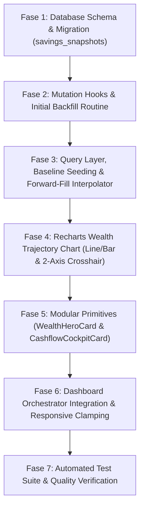

# PLANWEALTHCHART — Full-Width Wealth Hero Card & Historical Wealth Trajectory Chart

> **Status:** IN PROGRESS  
> **Goal:** Merombak Tier 1 Dashboard utama (`/dashboard`) menjadi full-width viewport-fitted Wealth Cockpit dengan visualisasi grafik interaktif histori akumulasi simpanan (Line & Bar, rentang Harian/Mingguan/Bulanan/Tahunan, 2-axis dashed crosshair tooltip) yang ditenagai oleh tabel time-series `savings_snapshots`, serta mereposisi Cockpit Arus Kas bulanan tepat di bawahnya.  
> **Aturan eksekusi:** 1 fase per iterasi → `IMPLEMENTED — AWAITING APPROVAL` → approve Ken (ceklis kotak) → tanya Ken apakah lanjut → lanjut ke fase berikutnya hanya bila diinstruksikan.

---

## 0. Ringkasan Temuan & Baseline Arsitektur

1. **Kondisi Skema Saat Ini (`src/db/schema.ts`):**
   - Tabel `savings_account` hanya menyimpan 1 baris scalar per pengguna (`balance` dan `emergency_fund_balance`) yang selalu ditimpa di tempat (*in-place update*).
   - Tidak ada catatan saldo di masa lalu (*zero historical balance points*).
   - Tabel `transactions` hanya mencatat belanja operasional pos anggaran bulanan, bukan mutasi tabungan atau dana darurat.

2. **Kondisi Komponen Dashboard Saat Ini:**
   - `ExecutiveWealthBento.tsx` saat ini berformat Bento Grid 2 kolom asimetris 65:35 (`lg:col-span-7` untuk Brankas dan `lg:col-span-5` untuk Arus Kas).
   - Di bawah angka Rp 9.500.000 sebelumnya terdapat 2 kartu mikro ringkas (*Tabungan Bebas* & *Dana Darurat*).

3. **Baseline Library Grafik & Interaksi Crosshair:**
   - Proyek sudah memiliki **Recharts v3.10.1** yang terpasang dan terbukti stabil di `AnalyticsDashboard.tsx`.
   - Menggunakan Recharts menghindari risiko hidrasi SSR React 19 / Next.js 16 dan menghemat ~45KB bundle size dibanding menginstal library baru.
   - Efek 2-axis dashed crosshair (garis putus-putus ke sumbu X dan Y saat hover) diimplementasikan via kursor Recharts bawaan dipadukan dengan dynamic SVG `<ReferenceLine y={hoveredValue} strokeDasharray="4 4" />` di mana `hoveredValue` adalah nominal Rupiah data domain saat hover.

---

## 1. Keputusan Kunci yang Memerlukan Persetujuan

| No | Topik Keputusan | Rekomendasi Terpilih | Status |
| :--- | :--- | :--- | :--- |
| **K1** | **Diagram Tipe Visualisasi** | Garis (Area gradient kurva) dan Batang (Bar delta/volume). Candlestick dieliminasi karena tabungan pribadi tidak memiliki volatilitas harga harian (OHLC). | Disetujui Kenzo |
| **K2** | **Layout & Clamping Tinggi** | Kartu Hero dibuat Full Width (100%). Tinggi desktop di-clamp adaptif `lg:min-h-[460px]` hingga `h-[520px]`, sedangkan di mobile dibatasi `h-[360px]` agar Cockpit Arus Kas di bawahnya tidak tenggelam. | Disetujui Kenzo |
| **K3** | **Library Visualisasi** | Recharts v3 (reuse library eksisting) dengan dynamic SVG ReferenceLine crosshair horizontal untuk zero bundle bloat dan integrasi tema dark/light Tailwind. | Disetujui Kenzo |
| **K4** | **Data Persistence** | Tabel time-series baru `savings_snapshots` mencatat `freeSavingsBalance`, `emergencyFundBalance`, `totalBalance`, `deltaAmount`, dan `sourceEvent`. | Disetujui Kenzo |

---

## 2. Peta Fase & Dependensi (Mermaid)

---

## 3. Rincian Fase & Checklist Eksekusi

### [x] Fase 1 — Database Schema & Migration (`savings_snapshots`)
- [x] Buat entitas tabel `savings_snapshots` di `src/db/schema.ts`:
  - Kolom:
    - `id`: `uuid("id").defaultRandom().primaryKey()`
    - `userId`: `uuid("user_id").references(() => users.id, { onDelete: "cascade" }).notNull()`
    - `snapshotDate`: `date("snapshot_date").notNull()`
    - `freeSavingsBalance`: `integer("free_savings_balance").notNull().default(0)`
    - `emergencyFundBalance`: `integer("emergency_fund_balance").notNull().default(0)`
    - `totalBalance`: `integer("total_balance").notNull().default(0)`
    - `deltaAmount`: `integer("delta_amount").notNull().default(0)`
    - `sourceEvent`: `text("source_event").notNull()` (e.g. `'initial' | 'month_sweep' | 'month_reopen' | 'top_up' | 'emergency_transfer' | 'emergency_withdraw' | 'wishlist_allocate' | 'wishlist_withdraw'`)
    - `createdAt`: `timestamp("created_at", { withTimezone: true }).defaultNow().notNull()`
  - Indeks performa:
    - `index("savings_snapshots_user_date_idx").on(table.userId, table.snapshotDate)`
    - `index("savings_snapshots_user_created_idx").on(table.userId, table.createdAt)`
- [x] Daftarkan relasi `savingsSnapshots` pada `usersRelations` di `src/db/schema.ts`.
- [x] Jalankan pembuatan migrasi via Drizzle Kit (`bun run db:generate`).
- [x] Terapkan migrasi ke database Supabase (`bun run db:migrate` / `bun run db:push`).
- [x] Verifikasi schema: `tsc --noEmit` PASS (0 errors).

---

### [x] Fase 2 — Centralized Snapshot Mutation Hooks & Initial Backfill
- [x] Buat modul pembantu atomik `src/lib/savings-snapshots.ts`:
  - Fungsi `recordSavingsSnapshot(tx, params)` untuk mencatat snapshot saat terjadi mutasi tabungan/darurat di dalam transaksi Drizzle secara deterministik (`totalBalance = freeSavingsBalance + emergencyFundBalance`).
- [x] Pasang hook `recordSavingsSnapshot` pada Server Actions terkait:
  - `src/actions/savings.ts`: `transferToEmergencyFund`, `withdrawFromEmergencyFund`, `topUpFreeSavings`.
  - `src/actions/months.ts`: `closeMonth` (saat month sweep saldo), `reopenMonth` (saat pembatalan sweep).
  - `src/actions/wishlists.ts`: `allocateSavings`, `withdrawFromWishlist`.
- [x] Buat Server Action backfill terisolasi `backfillInitialSnapshots(userId)` di `src/actions/savings.ts`:
  - Beroperasi murni pada lapisan write (terpisah dari read queries) untuk menyintesis snapshot baseline dari akumulasi `months.sweptAmount` masa lalu dan saldo `savings_account` saat ini.
- [x] Verifikasi Server Actions: `bun test src/actions/__tests__/` PASS.

---

### [x] Fase 3 — Query Layer, Baseline Seeding & Forward-Fill Interpolator
- [x] Buat kontrak tipe data time-series di `src/types/savings-snapshots.ts` dan ekspor di `src/types/index.ts`:
  - `TimeframeOption = 'daily' | 'weekly' | 'monthly' | 'yearly'`.
  - `WealthSnapshotPoint = { date: string; label: string; freeSavings: number; emergencyFund: number; totalWealth: number; delta: number }`.
  - `AllTimeframeSnapshots = Record<TimeframeOption, WealthSnapshotPoint[]>`.
- [x] Implementasikan query read-only `getAllTimeframeSnapshots(userId)` di `src/lib/queries/savings-snapshots.ts`:
  - **Penanganan Collision Tanggal Sama (F-03):** Menciutkan multiple snapshots pada tanggal yang sama dengan mengambil baris snapshot penutupan terakhir di hari tersebut (highest `createdAt` / `id`).
  - **Penanganan Inaktivitas & Baseline Seeding (F-02):** Mengambil snapshot terakhir *pada atau sebelum* tanggal awal jendela timeframe (`snapshotDate <= startDate`) sebagai baseline saldo awal. Jika belum ada snapshot, gunakan saldo `savings_account` berjalan.
  - **Forward-Fill Gap Interpolation:** Mengisi kekosongan tanggal antar mutasi pada rentang harian (30D) dan mingguan (12W) dengan meneruskan nilai saldo terakhir (*last known balance*), menghasilkan titik data kontinyu untuk Recharts.
- [x] Buat unit test query layer `src/lib/queries/__tests__/savings-snapshots.test.ts` untuk memvalidasi algoritma forward-fill dan deduplikasi tanggal.

---

### [ ] Fase 4 — Recharts Wealth Trajectory Chart (`WealthTrajectoryChart.tsx`)
- [ ] Buat komponen klien `src/components/features/dashboard/WealthTrajectoryChart.tsx`:
  - Props: `snapshotsByTimeframe: AllTimeframeSnapshots`, `initialTimeframe?: TimeframeOption`.
  - State lokal klien: `selectedTimeframe` (`daily` | `weekly` | `monthly` | `yearly`) dan `chartMode` (`line` | `bar`). Pergantian tab berjalan 100% instan (0ms) dari pre-fetched series tanpa network waterfall.
  - Tampilan Tab Timeframe Responsif (F-06): Di desktop menggunakan label panjang (`Harian`, `Mingguan`, `Bulanan`, `Tahunan`), di layar ponsel (`< sm`) otomatis beralih ke label kompak (`30D`, `12W`, `12M`, `All`).
  - Toggle Mode Visualisasi: `Garis` vs `Batang` menggunakan `SlidingSegmentedControl` kompak.
- [ ] Implementasi Mode Garis (Area Chart):
  - Area kurva halus (`type="monotone"`) dengan gradient warna hijau emerald semantik (`emerald-500` ke transparan).
- [ ] Implementasi Mode Batang (Bar Chart):
  - Bar volume akumulasi/delta dengan rounded top corners (`radius={[6, 6, 0, 0]}`).
- [ ] Implementasi Interaktivitas 2-Axis Dashed Crosshair (F-09):
  - Vertical crosshair: `cursor={{ stroke: 'hsl(var(--muted-foreground))', strokeDasharray: '4 4' }}`.
  - Horizontal Y-axis crosshair: dynamic `<ReferenceLine y={hoveredValue} strokeDasharray="4 4" />` yang mengikuti nominal Rupiah aktif saat kursor mouse melayang di atas titik data (`onMouseMove`).
  - Custom Tooltip mengambang dengan format mata uang sans-serif `tabular-nums` (`formatRupiah`) dan tanggal bahasa Indonesia.
  - Floating sticky readout strip untuk navigasi drag sentuh di layar ponsel (*mobile touch ergonomics*).
- [ ] Invarian Desain: 100% sans-serif dengan `tabular-nums`, 0% `font-mono`, 0 literal emojis.

---

### [ ] Fase 5 — Modular Primitives (`WealthHeroCard.tsx` & `CashflowCockpitCard.tsx`)
- [ ] Buat `src/components/features/dashboard/WealthHeroCard.tsx`:
  - Container kartu lebar penuh (`w-full rounded-2xl border border-border/80 bg-card p-5 sm:p-6 shadow-xs`).
  - Header: Label `Total Brankas Simpanan`, Badge `Safety Months`, dan tautan `Buka Detail Brankas` ke `/dashboard/vault`.
  - Headline angka total saldo (`text-3xl sm:text-4xl font-extrabold tabular-nums`).
  - **Sub-Vault Inset Chips (F-07):** Menyajikan 2 chip metrik kompak untuk *Tabungan Bebas* (`freeSavingsBalance`) dan *Dana Darurat* (`emergencyFundBalance`) agar pengguna tetap dapat melihat proporsi likuid vs cadangan darurat.
  - Sematkan `<WealthTrajectoryChart snapshotsByTimeframe={snapshots} />` di area konten utama.
- [ ] Buat `src/components/features/dashboard/CashflowCockpitCard.tsx`:
  - Container kartu lebar penuh (`w-full rounded-2xl border border-border/80 bg-card p-5 sm:p-6 shadow-xs`).
  - Menampilkan ringkasan arus kas siklus berjalan: Badge Status Kesehatan Anggaran (*Sehat / Waspada / Defisit*), headline *Sisa Kuota Uang Bebas (Surplus)*, rincian 2 baris Pemasukan vs Belanja, dan progress bar penyerapan kas.
- [ ] Ekspor kedua komponen baru di `src/components/features/dashboard/index.ts`.

---

### [ ] Fase 6 — Dashboard Orchestrator Integration & Responsive Clamping
- [ ] Perbarui Server Component `src/app/(dashboard)/dashboard/(overview)/page.tsx`:
  - Tambahkan fetch `getAllTimeframeSnapshots(userId)` ke dalam `Promise.all` paralel tanpa menambah latency.
  - Pasang `<WealthHeroCard />` di posisi teratas Tier 1.
  - Pasang `<CashflowCockpitCard />` tepat di bawahnya sebagai Tier 2.
  - Pertahankan batas baris Thin Orchestrator (F-05) dengan mengekstraksi kartu-kartu visual mandiri.
- [ ] Atur Clamping Tinggi Responsif:
  - Desktop: `lg:min-h-[480px]` (memberi ruang kanvas grafik ~300px).
  - Mobile: `h-[360px]` (memberi ruang kanvas grafik ~200px) agar kartu Cashflow Cockpit tetap terlihat di viewport awal.
- [ ] Perbarui `DashboardSkeleton.tsx`:
  - Susun skeleton Tier 1 Full-Width Card (Hero + Chart Skeleton) dan Tier 2 Full-Width Card (Cockpit Skeleton) untuk mencegah CLS saat loading data.

---

### [ ] Fase 7 — Automated Test Suite & Quality Verification
- [ ] Buat unit test suite komprehensif `src/components/features/dashboard/__tests__/WealthTrajectoryChart.test.tsx`:
  - Pengujian SSR rendering aman tanpa window/canvas crash.
  - Pengujian perpindahan mode Garis vs Batang.
  - Pengujian perpindahan timeframe Harian vs Mingguan vs Bulanan vs Tahunan.
  - Pengujian penegakan invarian zero monospace (`tabular-nums` check).
- [ ] Jalankan verifikasi statis & build penuh:
  - `bun run typecheck` PASS (0 errors).
  - `bun test` PASS (100% test suites passed).
  - `bun run build` PASS (11/11 Next.js static & dynamic routes compiled).
- [ ] Dokumentasikan perubahan di `.changelog/` dan perbarui `laporan.md`.

---

## 4. Risiko & Mitigasi

| Risiko | Dampak | Mitigasi |
| :--- | :--- | :--- |
| **Ketiadaan Data Snapshot Masa Lalu (Cold Start)** | Pengguna lama yang sudah punya transaksi akan melihat grafik kosong. | Sediakan Server Action backfill otomatis di Fase 2 yang mengambil titik data dari saldo saat ini dan `swept_amount` bulan-bulan yang telah ditutup. |
| **Chart Recharts Melompat saat Hover (Hydration/Jank)** | Frame drop atau layout jank saat render reference line dinamis. | Gunakan React state terisolasi di dalam komponen chart dengan debounce mikro (`useCallback` / `requestAnimationFrame`) untuk update koordinat hover Y. |
| **Keterbatasan Layar Ponsel (Mobile Overflow)** | Tombol tab dan kanvas grafik berdesakan di layar 360px. | Sediakan kontrol timeframe horizontal scrollable atau label ringkas (`30D`, `12W`, `12M`, `All`), serta clamp tinggi grafik mobile ke ~200px. |
| **Peningkatan Ukuran File `page.tsx`** | Melanggar aturan Thin Orchestrator (maksimal 300-400 baris). | Seluruh logika render grafik, event mouse hover, dan kalkulasi visual dibungkus murni di dalam `WealthTrajectoryChart.tsx`. `page.tsx` hanya menyalurkan data props. |

---

## 5. Definition of Done (Global)

- [ ] Tabel `savings_snapshots` terdaftar di database Drizzle dan migrasi berhasil diaplikasikan.
- [ ] Seluruh aksi mutasi saldo (setor darurat, tarik darurat, top-up bebas, month sweep, wishlist allocate) otomatis mencatat rekaman snapshot secara atomik.
- [ ] Komponen `WealthTrajectoryChart` dapat beralih antara kurva Garis dan Bar volume dengan mulus di 4 timeframe (Harian, Mingguan, Bulanan, Tahunan) secara instan di sisi klien.
- [ ] Interaksi hover menampilkan kursor putus-putus ke sumbu Y dengan nominal Rupiah akurat (`hoveredValue`).
- [ ] Kartu Hero tampil full-width dan responsive-clamped (desktop lega, mobile tetap ramah jempol).
- [ ] Kartu Cockpit Arus Kas berpindah tepat di bawah kartu Hero dengan visual yang rapi dan konsisten.
- [ ] Zero monospace font (`font-mono` = 0), seluruh angka menggunakan sans-serif proporsional dengan `tabular-nums`.
- [ ] Seluruh unit test lulus (`bun test`), tidak ada type error (`bun run typecheck`), dan build produksi Turbopack sukses (`bun run build`).
- [ ] Dokumentasi changelog dan `laporan.md` diperbarui dengan benar.
